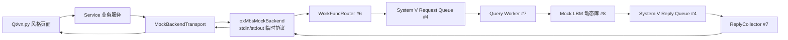
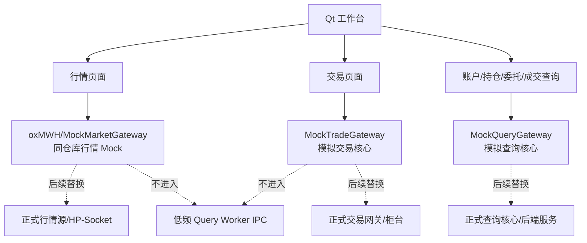
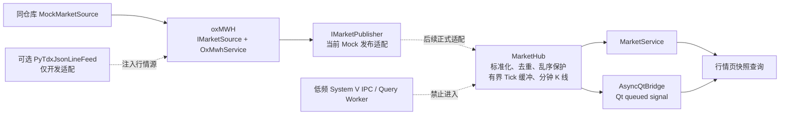
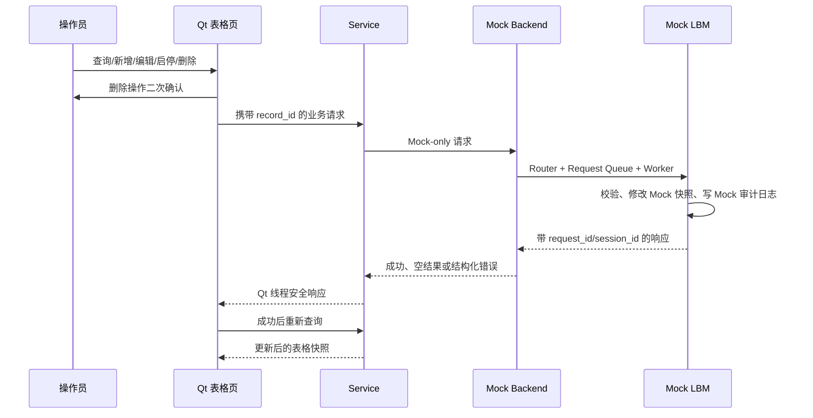
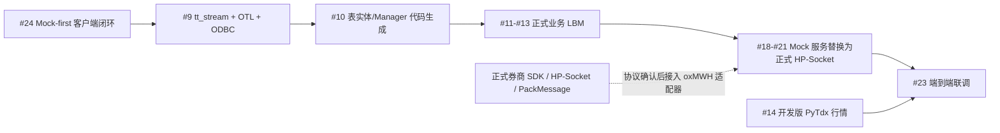

# oxApp

`oxApp` 是 UltraQuant 平台的 Qt 桌面客户端工程。本分支 `feature/14-market-routing`
在 #24 Mock 端到端基线上增加同仓库的 `oxMWH` 行情服务核心和客户端行情接入。
默认使用仓库内 Mock 行情源，保证不依赖、不启动其他项目即可离线构建和演示。

> **重要边界**：本分支的登录、权限、行情、资金、成交和风控结果全部是 `Mock-only`。
> 它们不代表真实登录、真实授权、真实数据库落库、正式生产行情、真实柜台报单或真实风控执行，
> 不会连接生产柜台、交易所或数据库。

## 当前状态

| 项目 | 状态 |
| --- | --- |
| 客户端 | 基于 vn.py Qt 组织方式改造，左侧导航、页签工作区和右侧运行状态面板已可运行 |
| 管理功能 | 菜单、字典、日志、服务状态、用户、角色、站点、托管服务和权限关系 Mock 闭环 |
| 产品资金 | 产品、项目、资金账号、资产-资金账号关联 Mock 查询和 CRUD |
| 风控 | 参数、规则、事件 Mock 查询、编辑、启停/处理 |
| 行情 | `oxMWH` 标准化、订阅、重复/乱序保护；客户端报价、Tick、1 分钟 K 线、五档盘口和 Mock 展示 |
| 交易 | 限价委托、数量校验、资金/仓位冻结、撤单、模拟成交和查询 |
| 后端基础设施 | 管理类请求实际经过 #1-#8 的路由、System V IPC、Query Worker、动态 Mock LBM |
| 正式后端 | #9-#13 数据访问层、正式 LBM、数据库和正式 HP-Socket 尚未接入 |

## 架构图

### Mock 端到端链路



管理类请求的 `request_id`、`session_id`、超时和错误状态会贯穿整个链路；页面只接收最终响应，
不会直接操作 Mock 数据容器、System V 队列或 C++ LBM。

### 行情、交易与查询边界



行情和交易故意不进入慢查询 IPC；它们只共享客户端请求关联和错误模型，避免把高频链路与低频管理查询混在一起。

### oxMWH 与客户端行情链路



`OxMwhService` 只负责行情源回调的字段校验、代码标准化、订阅过滤、源序号去重/乱序保护和发布，
不执行数据库、慢查询或交易逻辑。外部券商 SDK、正式 HP-Socket 和正式 PackMessage 通过接口适配，
待 Mentor 确认后接入。`MarketHub` 负责客户端快照、Tick/K 线缓存和 Qt 刷新；当前实现用于开发和演示，
不宣称生产级低时延，也不能用作真实下单或风控依据。

### 管理 CRUD 时序



## 功能说明

### 系统管理

- **系统菜单**：查询、关键字筛选、新增、编辑、启停、删除。
- **数据字典**：查询、筛选、新增、编辑、启停、删除。
- **字典明细**：查询、筛选、新增、编辑、启停、删除。
- **在线日志**：关键字筛选、级别筛选和分页；日志记录不可删除。
- **服务状态**：服务地址、状态、Worker 数、延迟和最近心跳；运行快照不可删除。

### 用户与权限

- 用户、角色、站点和托管服务支持查询、筛选、CRUD、启停/冻结。
- 站点 Mock 字段覆盖 IP 策略、MAC 配置占位、多点登录配置和状态展示。
- 角色菜单、用户菜单、产品和资产权限作为独立数据集展示和维护。
- 当前权限数据用于页面和错误状态演示，尚未作为正式后端鉴权依据。

### 产品、行情与交易

- 产品、项目、资金账号和资产-资金账号关联支持分页、筛选、CRUD 和状态切换。
- 行情页提供报价、Tick、1 分钟 K 线、盘口和订阅；默认生成 Mock 实时快照，也可切换到已有的 PyTdx Bridge。
- 交易页提供限价委托、数量校验、资金/仓位冻结、撤单、模拟成交，以及账户、持仓、委托、成交查询。
- 交易数据只存在于 Mock Gateway 进程内，重启后恢复初始快照。

## Build

Prerequisites:

- CMake 3.20 or newer
- C++17 compiler

Configure and build on Linux or WSL:

```bash
cmake -S . -B build -DCMAKE_BUILD_TYPE=Debug
cmake --build build -j
```

运行 C++ 测试：

```bash
ctest --test-dir build --output-on-failure
```

运行基础 C++ 程序：

```bash
./build/bin/oxApp
```

Run the oxMBS configuration and runtime logging bootstrap:

```bash
cp config/mbsconfig.ini.example config/mbsconfig.ini
./build/bin/oxMbsBootstrap config/mbsconfig.ini
```

`oxMbsBootstrap` 是工单 #3 的后台基础程序。它校验 INI 配置、创建本次运行日志、
输出关键事件，并报告 Linux/WSL CPU、内存和磁盘信息；它不是本次 Mock 客户端的完整业务入口。

## Layout

```text
config/     Checked-in configuration templates only
docs/       Architecture and development notes
include/    Public C++ headers
src/        Application source
tests/      CTest-based automated tests
client/     #16 Python/vn.py extension, Mock transport and Qt page shell
```

## Mock 端到端客户端

`client/vnpy_oxapp` 是基于 vn.py Qt 组织方式改造的独立客户端扩展：它提供可替换的通信接口、
统一请求/响应/错误模型、会话、客户端日志、控件加载耗时和左侧导航工作台。页面只依赖 Service
接口，不直接读取 Mock 容器或数据库。

三条路径共用异步请求关联和错误模型，但行情/交易不会进入慢查询 IPC；同仓库 `oxMWH` 核心已经提供
行情源和发布端抽象，正式 HP-Socket、券商 SDK、交易网关、查询核心和真实 LBM 仍在后续工单接入。

安装依赖并运行：

```bash
python3 -m venv .venv
. .venv/bin/activate
python -m pip install -r client/requirements.txt
PYTHONPATH=client python -m unittest discover -s tests/python -v
PYTHONPATH=client python -m vnpy_oxapp.app
```

## 运行方式

```bash
cmake --build build -j2
PYTHONPATH=client .venv/bin/python -m vnpy_oxapp.app
```

登录演示用户：`yangjh`；演示密码：`mock-password`。

### 行情配置

先生成本机配置，默认不用网络即可运行：

```bash
cp config/oxapp.ini.example config/oxapp.ini
# 保持 [market] source=mock
PYTHONPATH=client .venv/bin/python -m vnpy_oxapp.app
```

如需验证可选 PyTdx 开发适配，可在外部环境提供兼容的 JSON-lines 服务，再将本机配置改为：

```ini
[market]
source=pytdx
pytdx_host=127.0.0.1
pytdx_port=19001
reconnect_seconds=2
fallback_after_seconds=5
```

本仓库不会自动启动外部项目；服务不可用、网络断开或没有收到有效行情时，客户端仍使用仓库内 Mock 行情。
当前可选适配仅覆盖开发验证，期货、期权及生产行情商 SDK 需要后续按正式协议实现。

## 测试

在 **WSL Ubuntu 24.04** 中按顺序执行：

```bash
cd /root/projects/TA/oxApp
cmake --build build -j2
ctest --test-dir build --output-on-failure
PYTHONPATH=client .venv/bin/python -m unittest discover -s tests/python -v
PYTHONPATH=client .venv/bin/python -m compileall -q client/vnpy_oxapp
```

验收以以上命令的实际结果为准；测试覆盖 C++ 基础设施、Mock 端到端、行情字段标准化、TCP 拆包、重连、
Mock 回退、乱序去重、K 线聚合和 Qt 主线程交付。

## 运行流程

1. 构建 `build/bin/oxMbsMockBackend`。
2. 启动 Qt 客户端。
3. 在左侧导航切换系统管理、用户权限、产品资金、风控管理、行情中心、交易终端和登录会话。
4. 管理配置类页面的删除按钮会先弹出二次确认；在线日志、服务状态和风控事件不提供删除按钮。
5. 登录演示用户 `yangjh`，密码 `mock-password`。

运行日志默认写入仓库根目录的 `logs/oxTrader_YYYYMMDD_HHMMSS.log`；`logs/`、`build/`、运行配置和凭据不会提交。

## 后续接入顺序



当前分支只验证客户端、#1-#8 基础设施和同仓库 oxMWH 开发核心，不提前宣称数据库、正式 LBM、正式 HP-Socket、
真实权限、生产低时延行情或真实交易完成。

## 开发边界

本分支只完成 Mock-first 的客户端可见业务演示和 #1-#8 基础设施联调。工单 #9-#13
仍未实现：`tt_stream/OTL/ODBC`、数据库表实体生成、正式 `lbm_sys/lbm_right/lbm_fund`
及真实持久化。正式 HP-Socket/PackMessage 也未接入，临时 stdin/stdout 协议和 Mock
消息编号不能作为生产协议使用。

详细链路、协议边界和后续替换点见 [Mock 端到端联调说明](docs/mock-backend-end-to-end.md) 和
[开发版行情路由说明](docs/architecture/market-routing.md)。

Local logs, build output, runtime configuration, credentials, and private keys
must not be committed.
