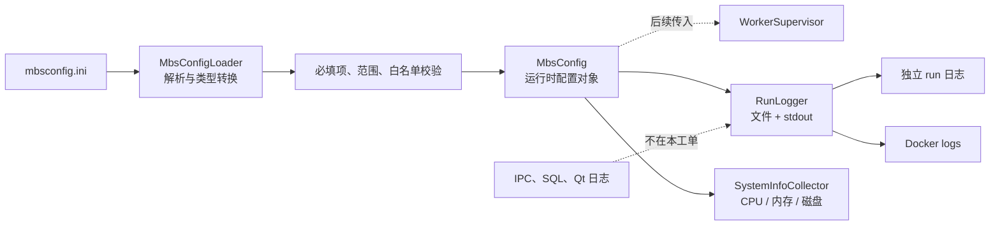
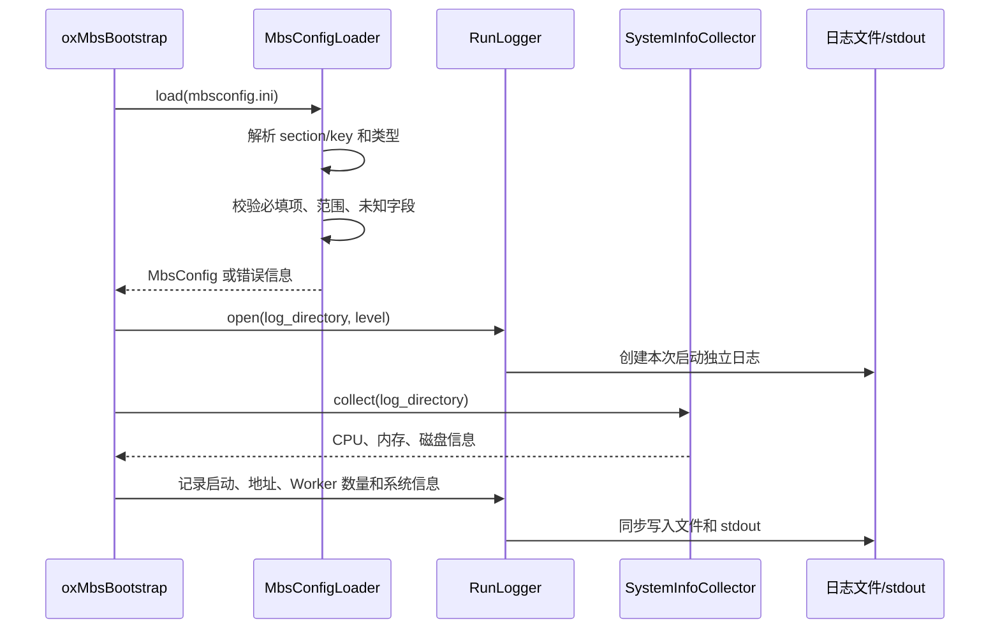

# oxMBS 配置与运行日志基础

## 工单边界

本工单在 #1 工程基线上增加后台配置、运行日志和基础系统信息采集，不接入
Worker、System V IPC、HP-Socket、数据库或业务模块。



## 启动数据流



## 配置范围

| Section | Key | 类型 | 约束 |
| --- | --- | --- | --- |
| `service` | `name` | string | 非空 |
| `service` | `environment` | string | 非空 |
| `server` | `host` | string | 非空 |
| `server` | `port` | uint16 | 1-65535 |
| `worker` | `query_worker_count` | size | 1-128 |
| `worker` | `shutdown_timeout_ms` | uint32 | 1-600000 |
| `logging` | `directory` | path | 非空，可创建 |
| `logging` | `level` | enum | DEBUG/INFO/WARN/ERROR |

未知 section、未知 key、重复 key、缺少必填 key 和非法值都会拒绝启动，并返回包含行号或字段名的诊断信息。

## 日志格式

```text
YYYYMMDD HHMMSSmmm|[5位pid][6位tid][module][level]: message
```

例如：

```text
20260819 101523042|[03210][012345][oxMBS][INFO]: service started
```

日志器使用互斥锁保护文件和 stdout 的整行写入，按最低级别过滤消息，每次 `open()` 创建新的时间戳日志文件；目录不存在时自动创建。

## 验收

```bash
cmake -S . -B build
cmake --build build
ctest --test-dir build --output-on-failure
./build/bin/oxMbsBootstrap config/mbsconfig.ini
```

验收重点：合法配置可转换为 `MbsConfig`，非法配置能定位原因；日志文件和 stdout 的关键事件格式一致；WSL 下可以读取 CPU、内存和日志目录所在磁盘信息。
