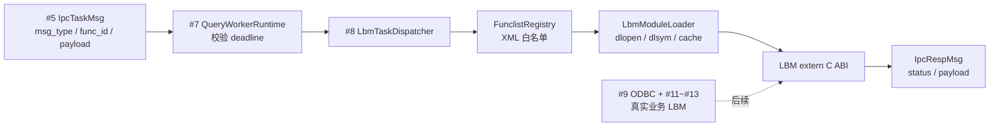
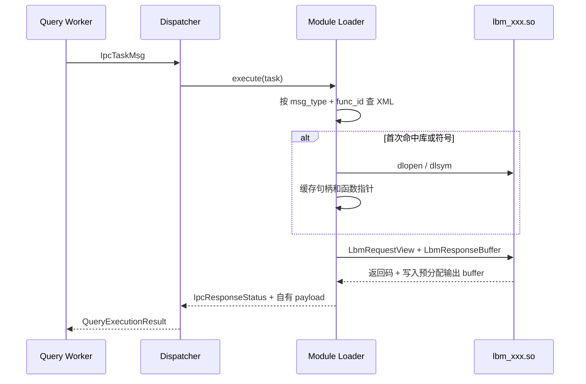

# 工单 8：funclist.xml 与 LBM 动态加载

## 目标和边界

本工单将 Query Worker 已解码的低频任务，按 `msg_type + func_id` 映射到 LBM 动态库和
`extern "C"` 导出函数。`funclist.xml` 在启动期校验；动态库和函数指针仅在第一次任务命中时
加载并缓存。

本工单不实现数据库连接、SQL、真实 `lbm_sys/lbm_right/lbm_fund`、正式 HP-Socket
消息枚举、用户登录鉴权或高频交易/行情处理。



## 配置格式

`mbsconfig.ini` 增加以下必填段。`funclist_file` 的相对路径以 ini 文件所在目录解释，避免服务
从不同工作目录启动时加载到错误配置。

```ini
[lbm]
funclist_file=funclist.xml.example
```

XML 根节点必须严格为 `<funclist>`；每条路由必须是自闭合 `<function />`，且只允许以下四个属性：

```xml
<funclist>
    <function msg_type="9001" func_id="42"
              library="./lbm/lbm_sys.so" symbol="oxmbs_lbm_sys_execute" />
</funclist>
```

- `msg_type`、`func_id`：非零十进制 `uint32`，共同构成唯一键。
- `library`：相对路径以 XML 文件所在目录解释；绝对路径保持绝对含义。
- `symbol`：模块通过 `extern "C"` 导出的函数名。
- 重复路由、额外属性、非 `function` 子节点、错误根节点或不完整 XML 都会拒绝加载，且不会破坏已生效路由。

`9001` 只是当前 Mock 验证编号，正式 `PackMessage` 的消息枚举必须由 Mentor 或服务端代码确认后替换。

## LBM ABI 与内存所有权



入口函数原型：

```cpp
extern "C" int lbm_execute(const LbmRequestView* request,
                            LbmResponseBuffer* response);
```

关键约束：

1. 入口函数返回 `0` 才表示模块调用成功；非零统一转为 `InvocationFailed` 和 IPC `Failed`。
2. 请求正文仅借给模块读取，模块不得保存 `payload` 指针。
3. 输出缓冲区由 Worker 分配和释放。模块只能写入给定地址和容量，不得替换 `payload` 指针、修改容量或跨 `.so` 分配内存。
4. Loader 验证 ABI 版本、响应状态、输出指针、容量和实际长度，再复制到自己的 `IpcPayload`，避免动态库内存跨边界释放。
5. Worker 在调用 Dispatcher 前仍先检查 `deadline_unix_ms`；过期任务不会加载或调用任何 LBM。

## 启动与所有权

`oxMbsBootstrap` 的顺序为：读取 ini -> 初始化 run 日志 -> 解析 `funclist.xml` -> 创建 IPC
队列 -> 创建 Worker -> 启动 Reply Collector。XML 错误会在创建 Worker 前终止启动。

每个 Worker 在自身进程内首次使用某条路由时才 `dlopen/dlsym`。缓存不跨进程共享，这是 fork
后的预期行为；动态库句柄只由该 Worker 的 `LbmModuleLoader` 持有，并在析构时 `dlclose`。

主进程依旧是 Request/Reply System V 队列的唯一创建和删除者。LBM 不接触网络会话、队列所有权
或主进程的 `TaskCorrelationRegistry`。

## 错误映射

| 场景 | Loader 结果 | IPC Response 状态 | 后果 |
| --- | --- | --- | --- |
| 未读取 XML | `ConfigurationNotLoaded` | `Rejected` | Worker 回错误应答。 |
| 未找到路由 | `RouteNotFound` | `Rejected` | 不加载任意库。 |
| `.so` 不存在或不可加载 | `LibraryLoadFailed` | `Failed` | 错误文本写入 payload。 |
| 导出函数不存在 | `SymbolNotFound` | `Failed` | 库句柄保留，可尝试其他有效符号。 |
| 函数返回非零 | `InvocationFailed` | `Failed` | 不信任模块输出。 |
| ABI/指针/容量/长度非法 | `InvalidModuleResponse` | `Failed` | 拒绝读取模块声称的结果。 |

## 验证

在 WSL Ubuntu 24.04 执行：

```bash
cmake -S . -B build -DCMAKE_BUILD_TYPE=Debug
cmake --build build -j
ctest --test-dir build --output-on-failure
```

`oxmbs_lbm_loader_test` 编译一个独立 mock `.so`，覆盖 XML 相对路径和重复路由、首次懒加载、
缓存复用、库不存在、符号不存在、非零返回、非法 ABI 响应，以及真实 Supervisor 子进程通过
System V Request/Reply 队列调用 LBM 并返回响应。
