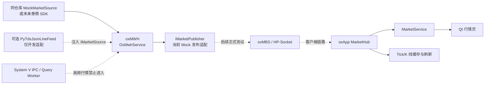
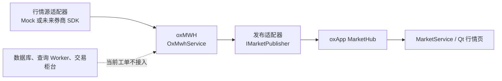
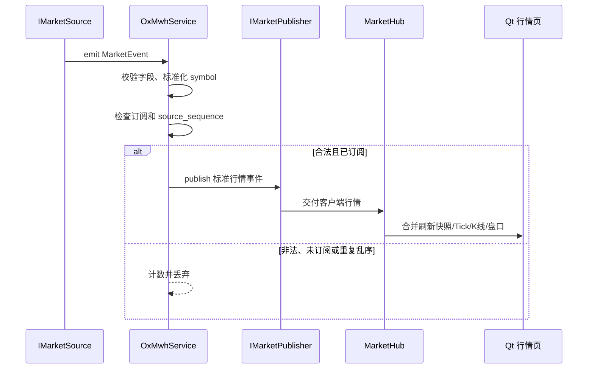
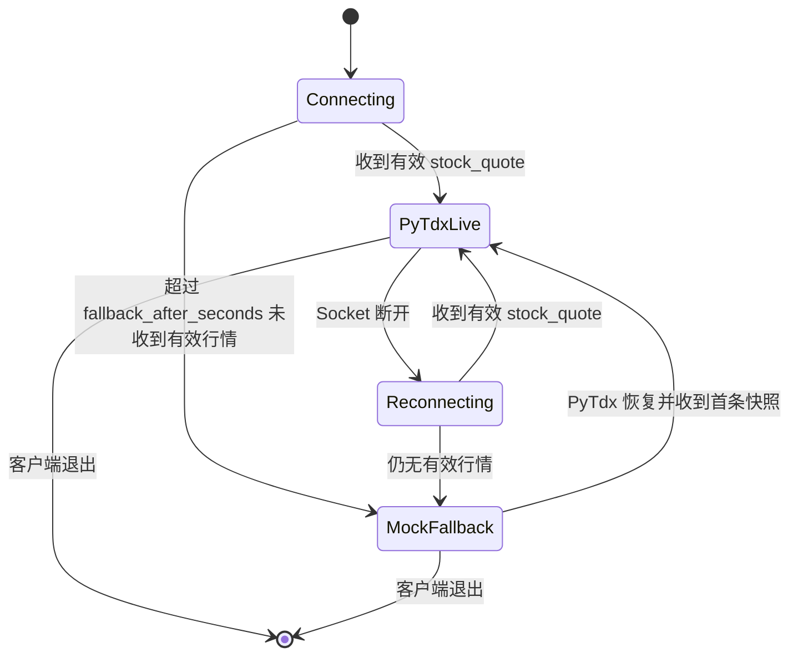

# #14 oxMWH 行情接入与 oxApp 路由

## 目标与边界

本工单只在 `oxApp` 仓库内实现行情接入和 `oxMWH` 核心。`oxMWH` 负责行情源适配、标准化、
订阅过滤、重复/乱序保护和向上游发布；客户端 `MarketHub` 负责页面侧缓存、Tick/K 线聚合和 Qt 刷新。
默认使用同仓库 Mock 行情源，保证不依赖、不启动其他项目即可构建和验收。

本工单不猜测券商私有协议、正式 HP-Socket 报文或未经 Mentor 确认的 SDK ABI；这些内容通过
`IMarketSource`/`IMarketPublisher` 适配器预留。当前 Mock 事件和可选 PyTdx 适配仅用于开发、页面和容错验证，
不能作为真实下单或风控决策依据。

## 数据流



## 当前工单图



本工单实现：同仓库 `oxMWH` 核心、Mock 行情源、标准化校验、订阅过滤、源序号保护和发布接口。
本工单不实现：数据库、低频 Query Worker、真实交易柜台、未经确认的 HP-Socket/券商私有协议。

## 标准化与缓存

`oxmwh::validate_event()` 只允许标准化后的标的、交易所、时间和有限价格/成交数据进入发布端。
`normalize_symbol()` 把 `600519.SSE` 规范为 `600519.SH`，把 `000001.SZSE` 规范为 `000001.SZ`；
Python 客户端仍使用自己的 `MarketEvent.from_bridge_payload()` 将外部开发字段转换成页面模型。

客户端模型保存两类时间：

| 字段 | 含义 | 用途 |
| --- | --- | --- |
| `source_time` | 行情源提供的时间 | 同标的乱序判断、分钟 K 线归桶。 |
| `received_at` | 客户端本机接收时间 | 排查源延迟与本机处理延迟，不能伪装成交易所时间。 |
| `sequence` | `MarketHub` 本机单调编号 | 方便日志、调试和订阅者观察接收顺序。 |

`MarketHub` 对每个标的维护最新快照、有界 `deque` Tick 缓冲和有界分钟 K 线：

1. 同一标的源时间倒退的消息直接丢弃，不能用旧盘口覆盖新盘口。
2. 指纹完全相同的消息判为重复，不重复触发 UI 或占用 Tick 缓冲。
3. 成交量和成交额按累计值差分聚合；首条快照没有上一累计值，因此增量为零；计数器回退时视为新时段起点，使用新累计值而非产生负数。
4. 后台行情线程只写 Hub。页面通过 `MarketService` 读取快照，且 `QTimer` 至少按 `ui_refresh_ms` 合并一次刷新。

## 处理时序



## 范围矩阵

| 范围 | 当前状态 | 说明 |
| --- | --- | --- |
| `oxMWH` 核心编排 | 已实现 | `OxMwhService` 负责源回调到发布端的快速处理。 |
| 同仓库 Mock 行情源 | 已实现 | `MockMarketSource` 可确定性地产生测试事件，不依赖外部项目。 |
| 客户端行情展示 | 已实现 | `MarketHub`、`MarketService` 和 Qt 页面已有快照/Tick/K线/盘口链路。 |
| 正式券商行情 SDK | 待协议确认 | 通过 `IMarketSource` 接入，不修改页面和核心编排。 |
| 正式 HP-Socket/PackMessage | 待协议确认 | 通过 `IMarketPublisher` 接入，不凭空写枚举或报文字段。 |
| 数据库、Query Worker、交易柜台 | 明确不在本工单 | 分别由 #9-#13、#15 和正式交易链路负责。 |

## 连接和回退状态机



`OxMwhService` 的行情回调只执行校验、订阅判断、源序号判断和发布调用，不执行数据库、慢查询或交易逻辑。
外部 TCP/SDK 源自行负责拆包、重连和线程退出；接入时只需实现 `IMarketSource`，发布端只需实现
`IMarketPublisher`，不改动页面和 `MarketHub`。可选 PyTdx 接收线程仍采用有限大小帧、换行拆包、坏包计数和退避等待，
但本仓库默认不启动它，也不依赖另一个项目。

## 配置和运行

本机从模板建立 `config/oxapp.ini`：

```ini
[market]
source=mock
pytdx_host=127.0.0.1
pytdx_port=19001
reconnect_seconds=2
fallback_after_seconds=5
ui_refresh_ms=200
tick_buffer_size=500
bar_buffer_size=480
mock_interval_ms=800
```

`source=mock` 是安全默认值，启动和测试只使用 `oxApp` 仓库内的 Mock 数据。
`source=pytdx` 仅是可选开发适配，必须由外部环境提供兼容 JSON-lines 服务；本仓库不会自动启动外部项目，
也不会把第三方服务器地址、账号或本机运行配置提交到本仓库。

## 代码与测试位置

| 功能 | 代码 | 验证 |
| --- | --- | --- |
| oxMWH 统一事件、代码标准化和行情字段校验 | `include/oxmwh/market_event.h`、`src/oxmwh/market_event.cpp` | `tests/test_oxmwh.cpp` |
| oxMWH 行情源/发布端抽象与订阅生命周期 | `include/oxmwh/market_source.h`、`include/oxmwh/market_publisher.h`、`include/oxmwh/oxmwh_service.h`、`src/oxmwh/oxmwh_service.cpp` | `tests/test_oxmwh.cpp`、`oxmwh_service_test` |
| 同仓库 Mock 行情源 | `include/oxmwh/mock_market_source.h`、`src/oxmwh/mock_market_source.cpp` | `tests/test_oxmwh.cpp` |
| 字段校验、symbol 映射、五档补齐 | `client/vnpy_oxapp/market/event.py` | `tests/python/test_market_event.py` |
| PyTdx TCP、拆包、订阅、重连、坏包统计 | `client/vnpy_oxapp/market/pytdx_feed.py` | `tests/python/test_pytdx_feed.py` |
| Mock 自动回退和恢复切换 | `client/vnpy_oxapp/market/runtime.py` | `tests/python/test_market_runtime.py` |
| 去重、乱序保护、有界 Tick、K 线聚合 | `client/vnpy_oxapp/market/hub.py` | `tests/python/test_market_hub.py` |
| 服务层兼容既有 Future/Response | `client/vnpy_oxapp/services/market_service.py` | `tests/python/test_market_service.py` |
| Qt 主线程信号和页面合并刷新 | `client/vnpy_oxapp/ui/qt_bridge.py`、`client/vnpy_oxapp/ui/market_page.py` | `tests/python/test_qt_thread_bridge.py` |

运行验收：

```bash
cmake --build build -j2
ctest --test-dir build --output-on-failure
PYTHONPATH=client .venv/bin/python -m unittest discover -s tests/python -v
PYTHONPATH=client .venv/bin/python -m compileall -q client/vnpy_oxapp
```
