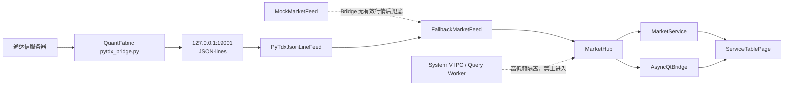
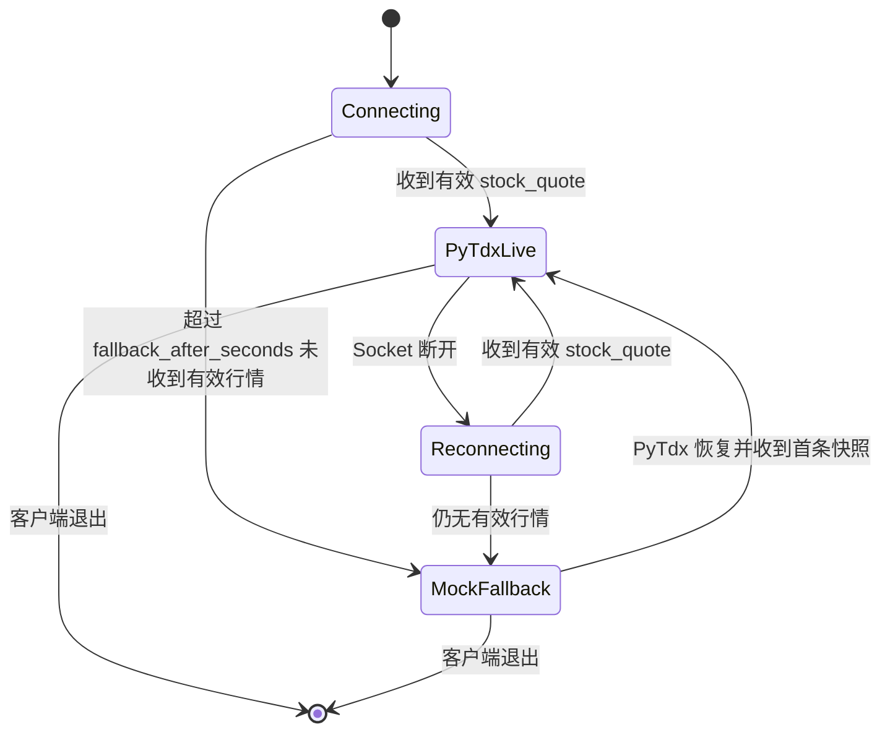

# #14 开发版行情路由

## 目标与边界

本工单复用另一个 WSL 项目中已经可运行的 QuantFabric PyTdx Bridge，将其 JSON-lines 行情接入
oxApp 行情页面。它解决开发时“页面有真实形状的数据、Bridge 断开仍可演示、代码未来可替换”的问题。

不实现通达信私有协议、正式 oxMWH、正式 HP-Socket、C++ 低延迟 SDK、真实交易柜台或数据库。PyTdx 的
Python 轮询和 JSON 编解码不适合作为生产低时延行情通道，不能作为真实下单或风控决策依据。

## 数据流



## 标准化与缓存

`MarketEvent.from_bridge_payload()` 只接受 `type=stock_quote`、沪深六位 ticker 和有限非负数值。
它把 `SSE + 600519` 规范为 `600519.SH`，把 `SZSE + 000001` 规范为 `000001.SZ`，补齐五档缺失档位，
并保存两类时间：

| 字段 | 含义 | 用途 |
| --- | --- | --- |
| `source_time` | Bridge 报文的 `update_time + millisec` | 同标的乱序判断、分钟 K 线归桶。 |
| `received_at` | 客户端本机接收时间 | 排查源延迟与本机处理延迟，不能伪装成交易所时间。 |
| `sequence` | `MarketHub` 本机单调编号 | 方便日志、调试和订阅者观察接收顺序。 |

`MarketHub` 对每个标的维护最新快照、有界 `deque` Tick 缓冲和有界分钟 K 线：

1. 同一标的源时间倒退的消息直接丢弃，不能用旧盘口覆盖新盘口。
2. 指纹完全相同的消息判为重复，不重复触发 UI 或占用 Tick 缓冲。
3. 成交量和成交额按累计值差分聚合；首条快照没有上一累计值，因此增量为零；计数器回退时视为新时段起点，使用新累计值而非产生负数。
4. 后台行情线程只写 Hub。页面通过 `MarketService` 读取快照，且 `QTimer` 至少按 `ui_refresh_ms` 合并一次刷新。

## 连接和回退状态机



PyTdx 接收线程采用有限大小帧、换行拆包、坏包计数和退避等待。订阅命令由独立写锁串行发送，避免连接重放订阅和
用户增量订阅把 JSON 行交叉写入同一 Socket。关闭时主动 `shutdown/close` Socket，使阻塞 `recv` 立即退出。

## 配置和运行

本机从模板建立 `config/oxapp.ini`：

```ini
[market]
source=mock
pytdx_host=127.0.0.1
pytdx_port=19001
reconnect_seconds=2
fallback_after_seconds=5
ui_refresh_ms=200
tick_buffer_size=500
bar_buffer_size=480
mock_interval_ms=800
```

`source=mock` 是安全默认值。`source=pytdx` 时，先启动 QuantFabric 的
`runtime/pytdx-bridge.sh`；该脚本读取 `runtime/config/PyTdxBridge.json` 并监听 `127.0.0.1:19001`。
不要把第三方服务器地址、账号或本机运行配置提交到本仓库。

## 代码与测试位置

| 功能 | 代码 | 验证 |
| --- | --- | --- |
| 字段校验、symbol 映射、五档补齐 | `client/vnpy_oxapp/market/event.py` | `tests/python/test_market_event.py` |
| PyTdx TCP、拆包、订阅、重连、坏包统计 | `client/vnpy_oxapp/market/pytdx_feed.py` | `tests/python/test_pytdx_feed.py` |
| Mock 自动回退和恢复切换 | `client/vnpy_oxapp/market/runtime.py` | `tests/python/test_market_runtime.py` |
| 去重、乱序保护、有界 Tick、K 线聚合 | `client/vnpy_oxapp/market/hub.py` | `tests/python/test_market_hub.py` |
| 服务层兼容既有 Future/Response | `client/vnpy_oxapp/services/market_service.py` | `tests/python/test_market_service.py` |
| Qt 主线程信号和页面合并刷新 | `client/vnpy_oxapp/ui/qt_bridge.py`、`client/vnpy_oxapp/ui/market_page.py` | `tests/python/test_qt_thread_bridge.py` |

运行验收：

```bash
cmake --build build -j2
ctest --test-dir build --output-on-failure
PYTHONPATH=client .venv/bin/python -m unittest discover -s tests/python -v
PYTHONPATH=client .venv/bin/python -m compileall -q client/vnpy_oxapp
```
