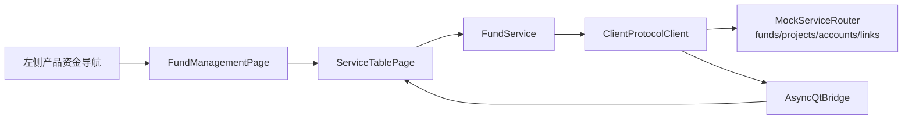

# 工单 #20：产品资金 Mock 页面

本工单实现产品、项目/资产、资金账号和产品项目关联四个标签页，验证产品到项目、项目到资金
账号的关联字段和筛选交互。

当前数据只用于页面和链路验收，不代表真实产品状态、真实资金余额或真实账户已变更；后续接入
LBM/HP-Socket 后保留页面字段和服务方法。

| 文件 | 内容 |
| --- | --- |
| `client/vnpy_oxapp/ui/fund_management_page.py` | 产品、项目、资金账号、关联关系四个页签。 |
| `client/vnpy_oxapp/services/fund_service.py` | 四类异步查询服务方法。 |
| `client/vnpy_oxapp/mock/mock_data.py` | 产品、项目、账号和关联 Mock 快照。 |
| `tests/python/test_fund_management_page.py` | 页面加载和表格行数验收。 |
