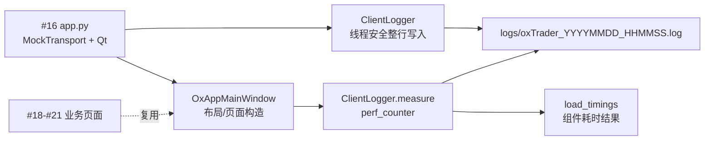
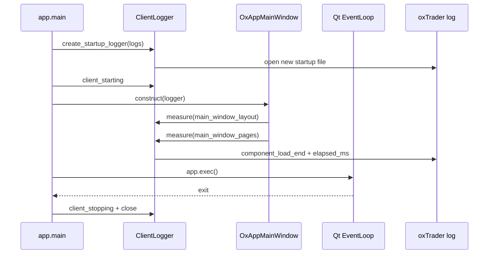

# 工单 #17：oxApp 客户端日志与控件加载耗时

## 目标和边界

本工单在 #16 客户端通信和 Qt 页面壳之上增加客户端运行日志与页面构造耗时统计。
每次启动创建 `oxTrader_YYYYMMDD_HHMMSS.log`，日志格式为：

```text
YYYYMMDD HHMMSSmmm|[5d-pid][6d-tid][module][level]: message
```



本工单实现：日志文件生命周期、日志级别、PID/TID/模块/时间格式、标准输出镜像、线程安全、
启动/停止/异常日志、窗口布局耗时、页面构造耗时和自动化测试。

本工单不实现：业务页面内容、真实 HP-Socket、数据库、LBM、交易、行情和后台日志查询页面。

## 运行时链路



## 文件职责

| 功能点 | 文件 | 关键符号 | 逻辑 |
| --- | --- | --- | --- |
| 日志器 | `client/vnpy_oxapp/logging.py` | `ClientLogger.open/log/close` | 创建日志目录和本次启动文件，按最低级别过滤，锁住文件与 stdout 的整行写入。 |
| 加载计时 | `client/vnpy_oxapp/logging.py` | `ClientLogger.measure` | `perf_counter` 记录代码块起止，正常/异常都输出结束日志并写入 `LoadTiming`。 |
| 启动接入 | `client/vnpy_oxapp/app.py` | `main` | 启动打开日志，记录启动/就绪/停止/异常，finally 关闭文件。 |
| 页面接入 | `client/vnpy_oxapp/ui/main_window.py` | `OxAppMainWindow.__init__` | 对布局和页面构造分别计时，保留 `load_timings` 给后续性能页面。 |
| 日志测试 | `tests/python/test_logging.py` | `ClientLoggerTest` | 验收文件名、格式、级别过滤和耗时记录。 |
| Qt 测试 | `tests/python/test_qt_thread_bridge.py` | `test_main_window_records_layout_and_page_load_timings` | 验收窗口确实产生布局/页面两条耗时记录。 |

## 验收命令

```bash
QT_QPA_PLATFORM=offscreen PYTHONPATH=client .venv/bin/python -m unittest discover -s tests/python -v
```

运行 Qt 客户端后，日志在仓库根目录的 `logs/` 下；该目录已经被 `.gitignore` 排除。
