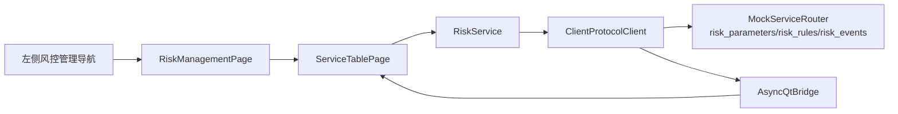

# 工单 #21：风控管理 Mock 页面

本工单完成前端 Mock-first 阶段的最后一个页面，包含风控参数、风控规则和异常事件三个标签页。

页面只展示 Mock 参数、规则和事件，不执行真实风控、不下单、不修改真实账户；真实后台替换时保留
相同的服务接口、请求关联和页面状态模型。

| 文件 | 内容 |
| --- | --- |
| `client/vnpy_oxapp/ui/risk_management_page.py` | 风控参数、规则、异常事件三个页签。 |
| `client/vnpy_oxapp/services/risk_service.py` | 三类异步查询服务方法。 |
| `client/vnpy_oxapp/mock/mock_data.py` | 参数、规则和异常事件 Mock 快照。 |
| `tests/python/test_risk_management_page.py` | 页面加载和标签切换验收。 |
