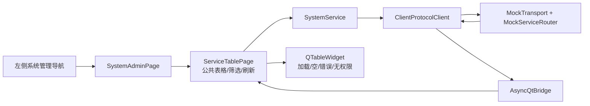

# 工单 #18：系统管理 Mock 页面

## 范围

本工单基于 #16 的服务接口和 #17 的日志/耗时能力实现系统管理 Mock 页面，包括系统菜单、
数据字典、字典明细和在线日志四个标签页。页面只通过 `SystemService` 发起异步请求，不直接
访问 Mock 数据存储。

## 已实现交互

| 页面 | Mock 数据 | 交互 |
| --- | --- | --- |
| 系统菜单 | 菜单编号、名称、父菜单、启用状态 | 关键字筛选、启用/停用筛选、刷新、表格展示。 |
| 数据字典 | 字典编号、分类、明细数量 | 关键字筛选、状态筛选、刷新。 |
| 字典明细 | 字典关联、值、显示名称、排序 | 关键字筛选、状态筛选、刷新。 |
| 在线日志 | 时间、操作员、级别、事件 | 关键字筛选、INFO/WARN 筛选、刷新。 |

页面响应链路是：`Future` 完成 -> Qt Signal -> request_id 匹配 -> 更新表格。后台 Timer 线程不
直接访问 QWidget；重复或不属于本页面的响应被忽略。

## 文件职责

| 功能 | 文件 | 关键符号 |
| --- | --- | --- |
| 公共表格交互 | `client/vnpy_oxapp/ui/table_page.py` | `DataTablePanel`、`ServiceTablePage` |
| 系统管理页 | `client/vnpy_oxapp/ui/system_admin_page.py` | `SystemAdminPage` |
| 系统服务 | `client/vnpy_oxapp/services/system_service.py` | `list_menus`、`list_dictionaries`、`list_logs` |
| Mock 数据 | `client/vnpy_oxapp/mock/mock_data.py` | `dictionaries`、`dictionary_details`、`system_logs` |
| 页面测试 | `tests/python/test_system_admin_page.py` | 标签切换和数据加载验收 |

本工单不实现真实后端、CRUD 持久化、真实权限校验、HP-Socket 或数据库。
