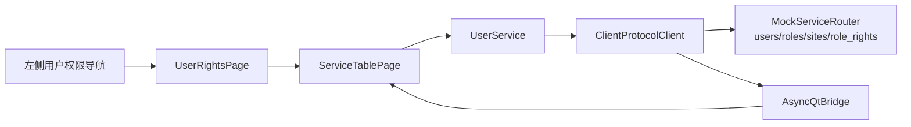

# 工单 #19：用户和权限 Mock 页面

本工单在 #18 公共表格组件上实现用户管理、角色管理、站点管理和角色菜单权限页面。

用户记录带有 `role_ids/site_ids`，权限记录带有 `role_id/menu_id`，用于验证关联字段和后续
筛选。当前为 Mock-only，冻结、CRUD 和权限变更不写真实数据库；真实操作接口将在后端 LBM 和
HP-Socket 接入后替换。

| 文件 | 内容 |
| --- | --- |
| `client/vnpy_oxapp/ui/user_rights_page.py` | 四个用户权限标签页和字段定义。 |
| `client/vnpy_oxapp/services/user_service.py` | 用户、角色、站点、角色菜单权限异步服务方法。 |
| `client/vnpy_oxapp/mock/mock_data.py` | 用户关系、角色、站点和权限 Mock 快照。 |
| `tests/python/test_user_rights_page.py` | 页面加载、标签切换和关联表格验收。 |
