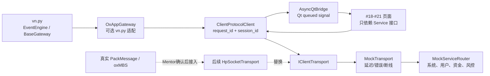
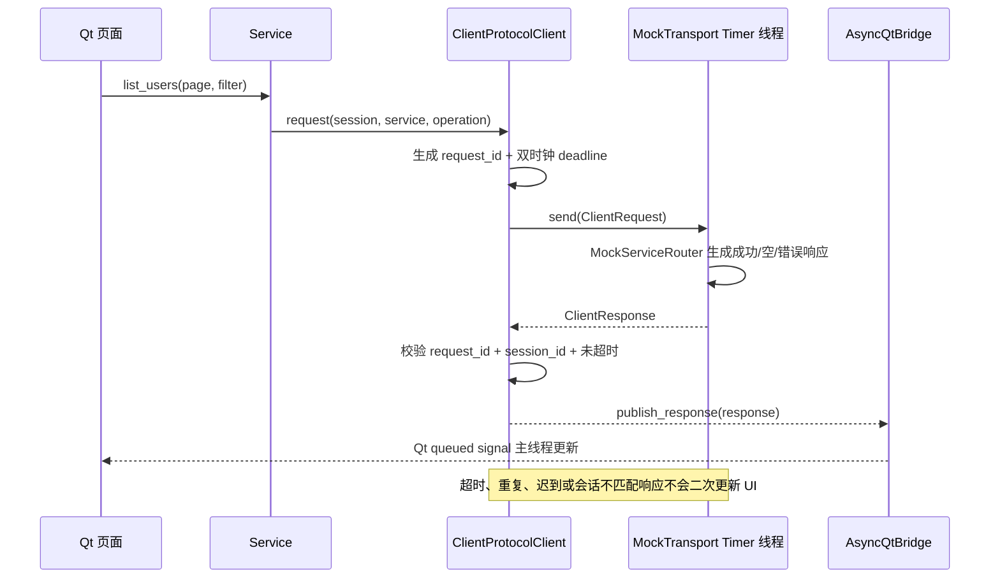

# 工单 #16：oxApp vn.py 客户端通信抽象与 Mock 服务

## 目标和边界

本工单在独立 `client/vnpy_oxapp` Python 包中扩展 vn.py 的 `BaseGateway` 使用方式，并提供
可替换的传输接口、确定性 Mock 服务、请求关联、Qt 线程桥接和公共页面容器。它不修改或复制
上游 vn.py 源码。



本工单实现：临时消息模型、JSON Mock Codec、传输接口、MockTransport、MockService、`Future`
请求接口、请求/响应关联、超时和重复/迟到包防护、vn.py Gateway 适配、Qt 页面基础壳。

本工单不实现：真实 HP-Socket、真实 PackMessage、真实登录鉴权、数据库/LBM、真实行情、真实
账户持仓、下单、撤单、成交或任何柜台行为。

## 请求时序



## 模块职责

| 模块 | 文件 | 输入 -> 处理 -> 输出 |
| --- | --- | --- |
| 临时消息契约 | `client/vnpy_oxapp/message.py` | 服务请求 -> 校验关联字段和绝对 deadline -> `ClientRequest/ClientResponse`。 |
| 可替换 Codec | `client/vnpy_oxapp/codec.py` | JSON bytes -> 显式字段和类型校验 -> 临时模型；将来替换为 PackMessage Codec。 |
| 请求关联 | `client/vnpy_oxapp/connection.py` | response -> `request_id + session_id + monotonic deadline` 判断 -> Future/UI 单次完成或拒绝。 |
| Mock 传输 | `client/vnpy_oxapp/mock/mock_transport.py` | request -> Timer 异步场景控制 -> 成功、错误、延迟、断线或不回包。 |
| Mock 服务 | `client/vnpy_oxapp/mock/mock_services.py` | service/operation/filter -> 分页和权限校验 -> 业务化 Mock payload。 |
| vn.py 适配 | `client/vnpy_oxapp/gateway.py` | client state/response -> vn.py EventEngine -> Monitor 可订阅 Event。 |
| Qt 安全边界 | `client/vnpy_oxapp/ui/qt_bridge.py` | Timer 线程回调 -> Qt Signal -> GUI 主线程。 |
| 页面公共壳 | `client/vnpy_oxapp/ui/main_window.py` | 导航选择 -> `QStackedWidget` -> 后续 #18-#21 页面插槽。 |

## 验收命令

```bash
PYTHONPATH=client python3 -m unittest discover -s tests/python -v
cmake -S . -B build -DCMAKE_BUILD_TYPE=Debug
cmake --build build -j
ctest --test-dir build --output-on-failure
```

安装 `client/requirements.txt` 后可启动 Mock 客户端：

```bash
PYTHONPATH=client python3 -m vnpy_oxapp.app
```

## 后续替换点

新增 `HpSocketTransport(IClientTransport)` 和正式 `PackMessageCodec` 后，保留
`ClientProtocolClient`、服务接口、请求关联和 Qt 页面层不变；MockTransport 继续作为 UI 状态和
回归测试的故障注入实现。
