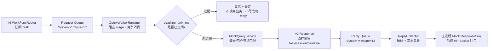
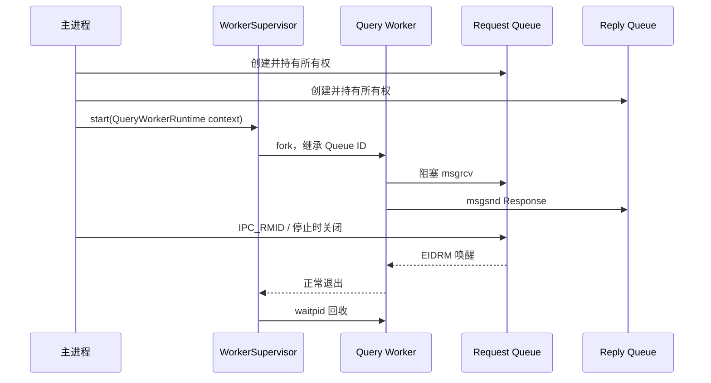

# 工单 #7：Query Worker 运行时与 Reply 回收

## 1. 目标和范围

本工单把 #2 的同质 Worker 生命周期、#4 的双 System V 队列、#5 的 v2 Task/Response 协议和 #6 的低频路由连成一条可运行的 Mock 查询链路。



本工单实现：Worker 阻塞竞争消费、协议解码、绝对 deadline 丢弃、可注入 Mock 执行入口、Response 编码与写回、Reply 回收、关联校验、超时 pending 清理、运行日志、队列删除唤醒和 Supervisor 上下文入口。

本工单不实现：真实 `PackMessage`、真实登录/密码/资金密码认证、数据库、权限、LBM 加载、`funclist.xml`、真实 HP-Socket 回包、Windows IPC 和交易/行情链路。

## 2. Worker 生命周期与所有权



- `IpcQueueManager` 仅由主进程创建和删除队列。
- `QueryWorkerRuntime` 与 `ReplyCollector` 只借用队列引用，绝不调用 `remove()`。
- #2 的 `WorkerSupervisor` 新增 `WorkerEntryWithContext`，让多个 Worker 从同一父进程运行时上下文启动；上下文对象必须在全部 Worker 被 `stop()` 回收后才能销毁。
- `QueryTaskHandler` 的 Mock 上下文当前是只读 `MockQueryService`，可以安全由子进程继承；未来 LBM/数据库上下文不能直接复用父进程连接，必须在 Worker 子进程内建立。
- Request Queue 的接收允许阻塞，多个同质 Worker 由 System V 内核竞争消费。WorkFunc 发送仍保持 #6 的 `IPC_NOWAIT`。

## 3. Mock 登录与用户查询

真实协议枚举和登录后端未提供，因此 `MockQueryService` 通过外部注入的临时消息类型工作。`9001/9002` 仅在测试中表示模拟登录和模拟用户查询，不是正式协议常量。

| Mock 类型 | 示例 Response | 限制 |
| --- | --- | --- |
| 模拟登录 | `mock-user-1001 / Mock Alice / operator` | 不读取或校验用户名、密码、资金密码。 |
| 模拟用户查询 | `mock-user-1001 / active / operator` | 不访问数据库，也不做权限判断。 |
| 未映射消息 | `Rejected` | 不伪装为成功结果，已有直接运行时测试覆盖。 |

后续真实认证只需替换 `QueryTaskHandler + handler_context`，不需要改动 Worker 收包、deadline 校验、Task/Response 编解码、ReplyCollector 或 IPC 所有权边界。

## 3.1 Bootstrap 启动顺序

当前 `oxMbsBootstrap` 已接入基础设施运行链路：

```text
读取配置和打开 run 日志
-> 安装主进程停止信号处理器
-> 主进程创建 Request/Reply Queue
-> 创建 QueryWorkerRuntime 并由 WorkerSupervisor fork Worker
-> 启动 ReplyCollector 独立线程
-> 后续 HP-Socket/WorkFunc 可开始接收低频消息
-> 主进程巡检 Worker 并清理 pending 超时
-> 停止时先 stop Worker，再由主进程删除队列唤醒 ReplyCollector
```

当前 Bootstrap 使用默认回显 Mock Handler，只验证基础设施可运行；Mock 登录和用户查询资料由测试注入 `MockQueryService` 验证。正式服务在 #8 以后通过 LBM Handler 替换，不能把 Mock 用户资料当作真实认证结果。

## 4. Task 和 Reply 处理规则

```text
Worker receive Request（阻塞）
-> decode_task v2
-> deadline_unix_ms <= 当前 Unix 毫秒？
   -> 是：记录 TaskExpiredDropped，丢弃，不执行业务，不写成功 Reply
   -> 否：调用 Mock/后续 LBM Handler
-> Handler 异常：组装 Failed Response，不杀死 Worker
-> encode_response
-> Reply Queue 阻塞发送

主进程 ReplyCollector receive Reply（阻塞）
-> decode_response v2
-> TaskCorrelationRegistry::resolve_response
-> task_seq + session_id + deadline 全部匹配？
   -> 否：记录 CorrelationRejected，不调用 ResponseSink
   -> 是：调用主进程 ResponseSink
```

Worker 返回 Response 时原样保留 `task_seq`、`session_id`、`deadline_unix_ms`、`msg_type` 和 `func_id`。`ReplyCollector` 只在 #5 的三重关联成功后才调用 Mock/未来 HP-Socket 回调，因此 Worker 从不接触客户端网络会话。

## 5. 失败与停止边界

| 场景 | Worker / Collector 行为 | 主进程影响 |
| --- | --- | --- |
| Request 帧损坏 | Worker 记录并丢弃，继续下一条。 | 不污染 pending。 |
| deadline 已过 | Worker 不执行业务、不写成功 Reply。 | `ReplyCollector::expire_pending()` 后续生成超时快照。 |
| Handler 异常 | Worker 写 `Failed` Response，继续运行。 | Collector 正常清理关联并回调。 |
| deadline/session/task 篡改 Reply | Collector 拒绝，不回调 sink。 | 正确 pending 保留到真正 Reply 或超时。 |
| 主进程 ResponseSink 异常 | Collector 记录 `ResponseSinkFailed` 并继续。 | 已消费的 Reply 不重复投递，后续 Reply 不受影响。 |
| Request/Reply Queue 删除 | 被阻塞的运行时收到 `QueueRemoved`，正常退出。 | 仍仅由主进程删除队列。 |
| 不可恢复 Receive/Reply Send 错误 | Worker/Collector 返回非零。 | Worker 可由 Supervisor 按异常路径重启。 |

## 6. 验收测试

| 测试 | 对应代码 | 验证内容 |
| --- | --- | --- |
| 单 Worker 登录和用户查询回环 | `tests/test_query_worker_runtime.cpp` | #6 Mock 消息 -> 父子进程 Worker -> ReplyCollector -> Mock ResponseSink，返回固定 Mock 用户资料。 |
| 过期 Task | 同上 | deadline 在 Handler 前丢弃，不调用 Handler，不写 Reply。 |
| 两 Worker 竞争消费 | 同上 | Supervisor 启动两个同质 Worker，多个请求由同一队列消费并完整回收。 |
| 坏 Task 后恢复 | 同上 | 坏帧被丢弃，后续合法 Task 仍处理。 |
| Handler 异常 | 同上 | 生成 `Failed` Response，Worker 不崩溃。 |
| Reply 篡改 | 同上 | deadline 被改写时拒绝回调，正确 Reply 仍可匹配。 |
| 主进程超时 | 同上 | `expire_pending()` 返回 task/session 并调用 Mock timeout sink。 |
| 队列删除 | 同上 | 真实 `fork` 子进程在 `IPC_RMID` 后从阻塞 `msgrcv` 醒来并正常退出。 |

构建与测试：

```bash
cmake --build build --parallel 2
ctest --test-dir build --output-on-failure
```
