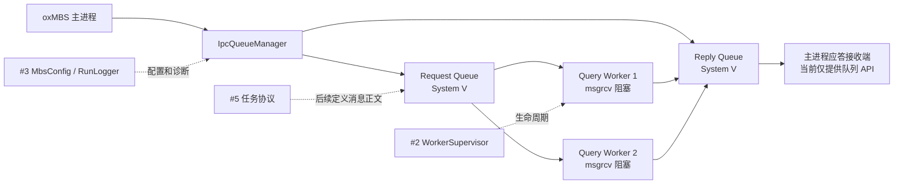
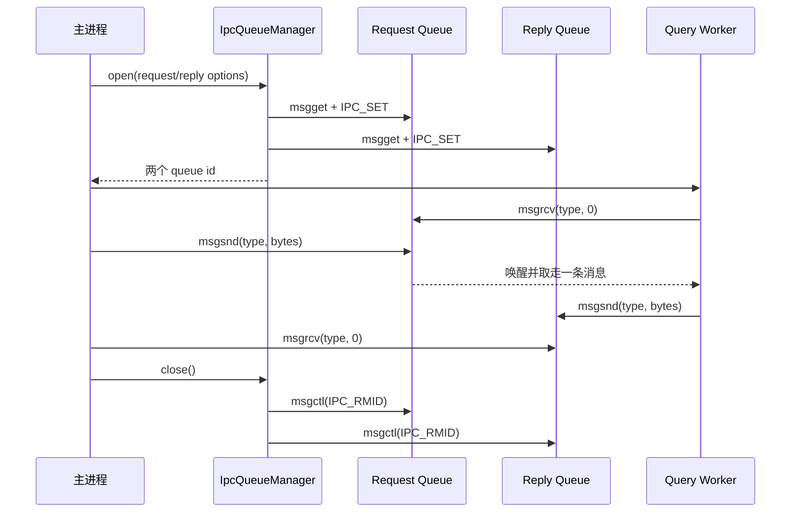

# System V 请求队列与应答队列

## 工单边界

本工单在 #2 Worker 生命周期和 #3 配置/日志基线上建立 Linux/WSL 的双
System V Message Queue。主进程拥有队列的创建和删除权，Worker 只收发消息；
消息正文是原始字节，不在本工单定义 `task_seq`、`session_id` 或业务字段。



范围结论：

```text
本工单实现：双队列创建、原始字节收发、阻塞/非阻塞模式、错误映射和清理回滚。
本工单不实现：业务消息协议、WorkFunc 路由、Worker 业务执行、LBM、数据库和 Windows IPC。
```

## 启动和停止顺序



## 完整端到端链路

主进程首先构造 `IpcQueueManager`，然后调用 `open()`。`open()` 先根据
`options.request` 创建 Request Queue，再根据 `options.reply` 创建 Reply Queue。
这两个队列分别承担“主进程到 Worker”和“Worker 到主进程”的单向通信，因此必须使用不同的
queue id。只有两次创建都成功，`is_open()` 才会返回 `true`，主进程此时才能启动或放行
Worker；如果 Reply Queue 创建失败，manager 会立即删除已经创建的 Request Queue，并把启动
结果作为失败返回，系统不会停留在只有请求通道、没有应答通道的半初始化状态。

双队列就绪后，主进程取得一段已经准备好的请求正文，调用
`request_queue().send(mtype, data, size, ...)`。本工单把正文视为原始字节，不解释字段、不添加
字符串终止符，也不负责业务序列化。封装层在临时内存中把它组织成
`[long mtype][size 个正文字节]`，再调用 `msgsnd()`；按照 System V ABI，传给 `msgsnd()` 的
`msgsz` 只是正文的 `size`，前面的 `long` 只供内核按类型路由，不能计入正文长度。

Worker 在 Request Queue 上调用 `receive()`。传入 `mtype == 0` 表示接收队列中的第一条消息，
传入正数则只接收相同类型的消息。阻塞模式下，如果暂时没有匹配消息，Worker 会停在
`msgrcv()` 中等待；非阻塞模式通过 `IPC_NOWAIT` 要求内核立即返回，并把空队列的 `ENOMSG`
映射为 `WouldBlock`。消息到达后，封装读取实际 `mtype`，仅把正文复制到调用方 buffer，并在
`ReceiveResult` 中返回正文的精确字节数。这个长度不包括 `long` 头，也不包括任何隐式终止符。

Worker 按后续工单定义的协议处理这段正文，得到应答正文后调用
`reply_queue().send(reply_mtype, data, size, ...)`。主进程在 Reply Queue 上调用 `receive()`，按
应答类型取回消息。至此，一次完整往返是：主进程写 Request Queue，Worker 从 Request Queue
取走请求，Worker 写 Reply Queue，主进程从 Reply Queue 取回应答。工单 #4 只保证这条原始字节
通道、类型路由和资源生命周期，正文中的任务号、会话号、长度字段及业务含义由工单 #5 定义。

任何 `msgsnd()`、`msgrcv()` 或 `msgctl()` 失败都会先取得 Linux `errno`，再映射成稳定的
`IpcResult`。例如，非阻塞暂不可用映射为 `WouldBlock`，缓冲区不足的 `E2BIG` 映射为
`MessageTooLarge`，权限错误映射为 `PermissionDenied`。上层因此可以按业务状态决定稍后重试、
扩大 buffer、退出 Worker 或报告系统资源问题，同时仍可从 `error` 文本查看具体系统调用和
`strerror` 诊断。

停止时，主进程调用 `close()`，manager 先删除 Request Queue，再删除 Reply Queue，并且即使
第一条删除失败也继续清理第二条。`IPC_RMID` 不只是释放内核资源，还会唤醒正在该队列的
`msgrcv()` 中阻塞的 Worker；接收端看到 `EIDRM`，封装将它转换为 `QueueRemoved`，Worker 可以
据此结束消费循环。若显式关闭因异常路径没有执行，`IpcQueueManager` 和
`SystemVMessageQueue` 的析构函数会用 RAII 再次兜底清理；`remove()` 是幂等的，移动构造和移动
赋值又会把 queue id 从源对象清空，因此同一内核队列在 C++ 层始终只有一个删除责任人。

## 消息内存边界

System V 的底层内存格式要求每条消息以 `long mtype` 开头，但 `msgsnd` 和
`msgrcv` 的 `msgsz` 只计算正文长度。本封装隐藏这一细节：

```text
业务调用 send(type, data, size)
-> 封装层分配 [long mtype][data bytes]
-> msgsnd(..., message_size=size)

msgrcv(...)
-> 封装层接收 [long mtype][data bytes]
-> 写入调用者 buffer 的正文区域
-> 返回 ReceiveResult{result, size, actual_message_type}
```

`#4` 只传输字节，不解释内容；`#5` 再引入 `IpcTaskMsg`、`IpcRespMsg` 和长度校验。

## 错误状态

| System V errno | 封装状态 | 含义 |
| --- | --- | --- |
| `EINTR` | `Interrupted` | 调用被信号打断 |
| `EAGAIN` / `ENOMSG` | `WouldBlock` | 非阻塞发送/接收暂时不能完成 |
| `E2BIG` | `MessageTooLarge` | 接收缓冲区不足 |
| `EIDRM` | `QueueRemoved` | 队列已被删除，阻塞调用被唤醒 |
| `EACCES` | `PermissionDenied` | IPC 权限不足 |
| `ENOSPC` / `ENOMEM` | `ResourceUnavailable` | 系统 IPC 资源不足 |
| `EINVAL` | `InvalidArgument` | queue id 或参数无效 |

## 所有权和回滚

```text
IpcQueueManager::open()
-> 创建 Request Queue
-> 创建 Reply Queue
-> Reply 创建失败：立即删除 Request Queue
-> 返回失败

IpcQueueManager::close()
-> 删除 Request Queue
-> 删除 Reply Queue
-> 合并错误信息
```

队列由主进程统一管理。Worker 不调用 `IPC_RMID`，这样 Worker 异常退出时不会破坏其他 Worker 或主进程的通信资源。

## 测试覆盖

`oxmbs_systemv_ipc_test` 覆盖：

1. 父进程发送请求，子进程阻塞接收并返回应答；
2. 校验消息正文、消息类型和字节长度不变；
3. 非阻塞空队列返回 `WouldBlock`；
4. 删除队列能唤醒阻塞的 `msgrcv`，返回 `QueueRemoved`；
5. Reply Queue 创建失败时回滚已经创建的 Request Queue；
6. 正常测试结束后 `ipcs -q` 不保留本工单创建的队列。

## 后续连接

```text
#4 System V 队列
-> #5 task/session 请求应答协议
-> #6 WorkFunc 低频消息路由
-> #7 Worker 阻塞消费和业务执行
```
