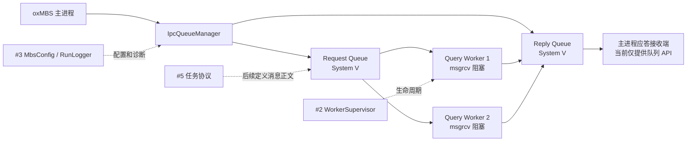
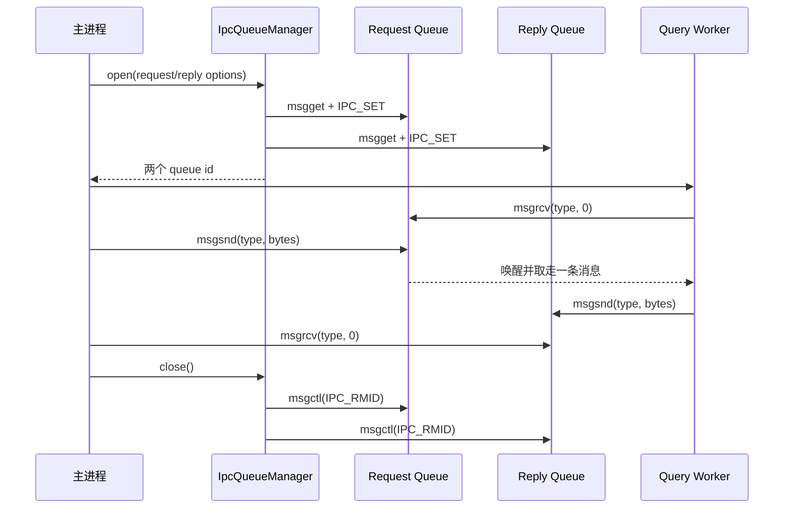

# System V 请求队列与应答队列

## 工单边界

本工单在 #2 Worker 生命周期和 #3 配置/日志基线上建立 Linux/WSL 的双
System V Message Queue。主进程拥有队列的创建和删除权，Worker 只收发消息；
消息正文是原始字节，不在本工单定义 `task_seq`、`session_id` 或业务字段。



范围结论：

```text
本工单实现：双队列创建、原始字节收发、阻塞/非阻塞模式、错误映射和清理回滚。
本工单不实现：业务消息协议、WorkFunc 路由、Worker 业务执行、LBM、数据库和 Windows IPC。
```

## 启动和停止顺序



## 消息内存边界

System V 的底层内存格式要求每条消息以 `long mtype` 开头，但 `msgsnd` 和
`msgrcv` 的 `msgsz` 只计算正文长度。本封装隐藏这一细节：

```text
业务调用 send(type, data, size)
-> 封装层分配 [long mtype][data bytes]
-> msgsnd(..., message_size=size)

msgrcv(...)
-> 封装层接收 [long mtype][data bytes]
-> 写入调用者 buffer 的正文区域
-> 返回 ReceiveResult{result, size, actual_message_type}
```

`#4` 只传输字节，不解释内容；`#5` 再引入 `IpcTaskMsg`、`IpcRespMsg` 和长度校验。

## 错误状态

| System V errno | 封装状态 | 含义 |
| --- | --- | --- |
| `EINTR` | `Interrupted` | 调用被信号打断 |
| `EAGAIN` / `ENOMSG` | `WouldBlock` | 非阻塞发送/接收暂时不能完成 |
| `E2BIG` | `MessageTooLarge` | 接收缓冲区不足 |
| `EIDRM` | `QueueRemoved` | 队列已被删除，阻塞调用被唤醒 |
| `EACCES` | `PermissionDenied` | IPC 权限不足 |
| `ENOSPC` / `ENOMEM` | `ResourceUnavailable` | 系统 IPC 资源不足 |
| `EINVAL` | `InvalidArgument` | queue id 或参数无效 |

## 所有权和回滚

```text
IpcQueueManager::open()
-> 创建 Request Queue
-> 创建 Reply Queue
-> Reply 创建失败：立即删除 Request Queue
-> 返回失败

IpcQueueManager::close()
-> 删除 Request Queue
-> 删除 Reply Queue
-> 合并错误信息
```

队列由主进程统一管理。Worker 不调用 `IPC_RMID`，这样 Worker 异常退出时不会破坏其他 Worker 或主进程的通信资源。

## 测试覆盖

`oxmbs_systemv_ipc_test` 覆盖：

1. 父进程发送请求，子进程阻塞接收并返回应答；
2. 校验消息正文、消息类型和字节长度不变；
3. 非阻塞空队列返回 `WouldBlock`；
4. 删除队列能唤醒阻塞的 `msgrcv`，返回 `QueueRemoved`；
5. Reply Queue 创建失败时回滚已经创建的 Request Queue；
6. 正常测试结束后 `ipcs -q` 不保留本工单创建的队列。

## 后续连接

```text
#4 System V 队列
-> #5 task/session 请求应答协议
-> #6 WorkFunc 低频消息路由
-> #7 Worker 阻塞消费和业务执行
```
