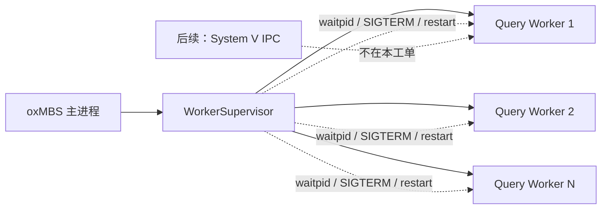
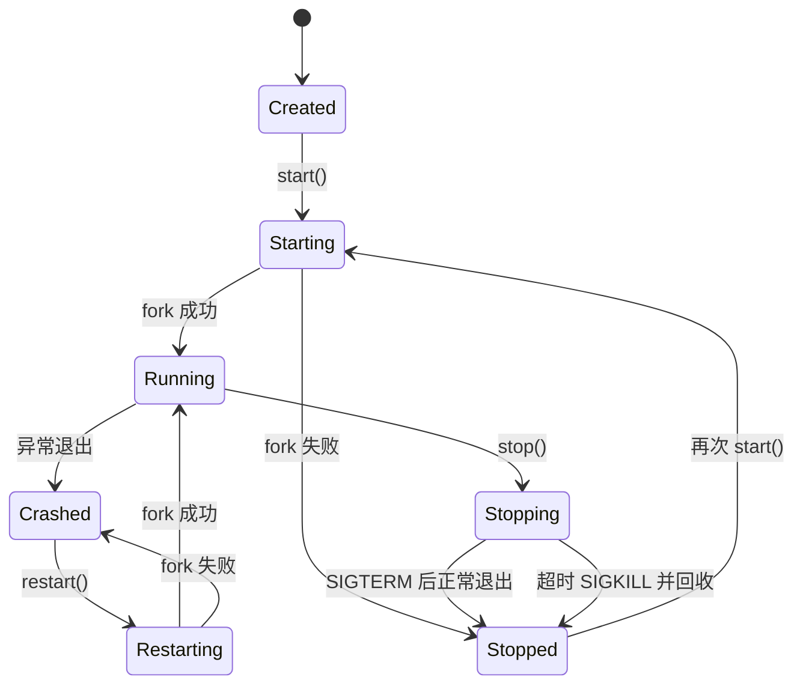
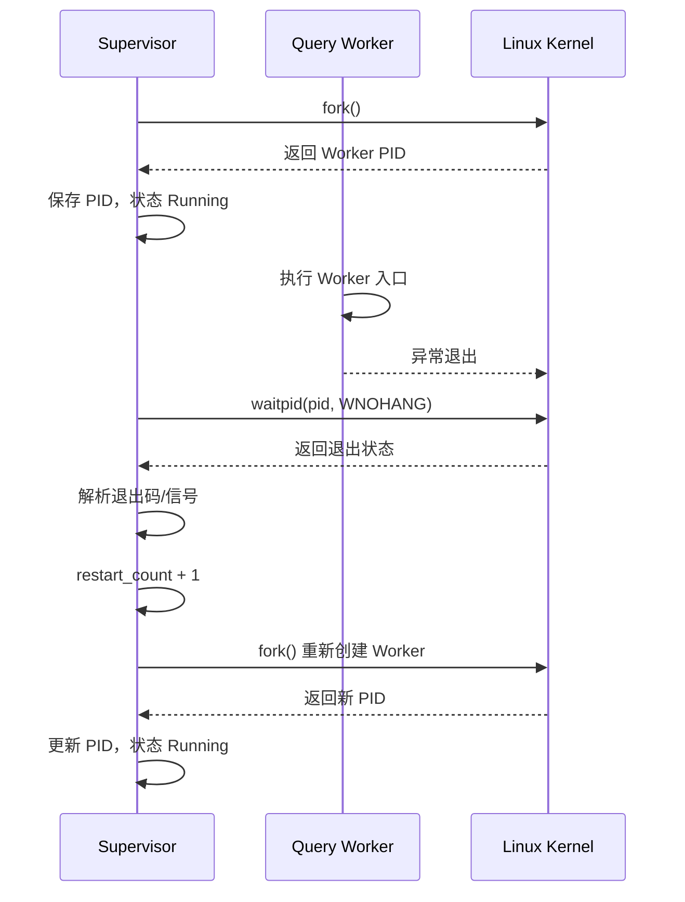

# Query Worker 进程池与 Supervisor

## 范围

本工单为 oxMBS/oxServer 增加 Linux/WSL 下的查询 Worker 进程生命周期管理。
Worker 当前只提供可运行的进程骨架，后续由 IPC 和业务执行工单接入请求处理。

本工单实现：

- Supervisor 创建指定数量的同质 Query Worker；
- 保存 Worker 的 PID、状态、启动时间、退出信息和重启次数；
- 使用非阻塞 `waitpid(..., WNOHANG)` 检查子进程是否退出；
- 异常退出后自动重启，保持目标进程数量；
- 通过 `SIGTERM` 请求优雅退出，超时后使用 `SIGKILL` 兜底；
- 父进程最终使用 `waitpid` 回收子进程，避免僵尸进程。

本工单不实现：

- System V 请求队列和应答队列；
- `task_seq`、`session_id` 等跨进程消息协议；
- WorkFunc 高低频路由；
- `funclist.xml`、LBM 动态加载；
- 数据库、OTL、ODBC 和具体查询业务；
- Windows IPC 适配。

## 进程结构



## Worker 状态变化



## 异常重启流程



## 测试覆盖

`oxapp_worker_supervisor_test` 覆盖：

1. 创建 2 个 Worker 并验证 PID 不同；
2. 验证正常停止和全部回收；
3. Worker 非零退出后由 Supervisor 自动重启；
4. 验证重启次数增加；
5. 拒绝 Worker 数量为 0 的配置。

## 后续接入顺序

```text
#2 Worker 生命周期
-> #4 System V IPC
-> #5 请求/应答协议
-> #7 Worker 阻塞消费和业务执行
-> #8 LBM 动态加载
```
