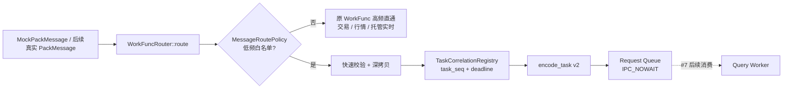

# 工单 #6：WorkFunc 高低频消息路由

## 1. 目标和范围

本工单在原有 `WorkFunc` 消息消费位置增加一个极轻量的低频转发分支。它复用工单 #4 的 Request Queue 和工单 #5 的 Task 协议/关联表，但不执行 Worker 业务、数据库、LBM 或 HP-Socket 回包。



本工单实现：可注入低频白名单、模拟 `PackMessage` 适配、快速校验、二进制深拷贝、关联登记、Task 编码、Request Queue 非阻塞投递、失败回滚与日志。

本工单不实现：真实 HP-Socket `PackMessage` 拆包、真实消息枚举、Worker 接收/过期丢弃/执行/Reply、LBM、数据库、登录认证、用户查询业务、客户端回包与任何高频链路改造。

## 2. Mock 适配边界

真实 `PackMessage` 定义和正式 `msg_type` 枚举尚未提供，因此 `MockPackMessage` 仅表示“WorkFunc 已解析得到的借用消息视图”：

| 字段 | Mock 含义 | 后续替换方式 |
| --- | --- | --- |
| `session_id` | 模拟连接 ID | 从真实连接/会话对象读取后赋值。 |
| `msg_type` | 注入的模拟消息类别 | 用正式 `PackMessage` 枚举映射，不改变 `MessageRoutePolicy` 接口。 |
| `func_id` | 模拟业务函数 ID | 后续由真实路由或 `funclist.xml` 填充。 |
| `data/data_len` | 上游借用二进制缓冲区 | 从真实消息正文取得；路由器仍先复制到 `IpcPayload`。 |

测试使用 `9001` 表示模拟登录、`9002` 表示模拟用户查询，二者仅出现在测试代码和可注入的测试白名单中，不属于正式通信协议。模拟登录正文示例 `{"user":"alice"}` 作为不透明字节传输，路由层不读取用户名、密码或任何业务字段。

## 3. 低频路由步骤

```text
MockPackMessage
-> 白名单判断
-> session/type/pointer/length 快速校验
-> 校验 payload <= max_frame_bytes - 56
-> 深拷贝 payload
-> register_request(session_id, timeout)
-> IpcTaskMsg(task_seq, session_id, deadline, msg_type, func_id, payload)
-> encode_task()
-> request_queue.send(mtype, frame, IPC_NOWAIT)
```

如果 Task 编码或非阻塞发送失败，调用 `cancel_request(task_seq, session_id, deadline)` 撤销刚登记的关联记录。这样队列满或异常时不会遗留“没有发出却稍后超时”的假请求。

## 4. 高频和失败边界

| 场景 | 路由结果 | 副作用 |
| --- | --- | --- |
| 白名单外交易、行情、托管实时消息 | `HighFrequencyPassthrough` | 不读取 payload、不登记、不进 IPC；即使误调用底层转发入口也受同一闸门保护。 |
| 低频消息字段非法 | `InvalidMessage` | 告警日志，不登记、不进 IPC。 |
| 超过协议最大长度 | `PayloadTooLarge` | 告警日志，不复制、不登记。 |
| 深拷贝内存不足 | `PayloadCopyFailed` | 告警日志，不登记。 |
| 关联表拒绝登记 | `RegistryRejected` | 告警日志，不进 IPC。 |
| 编码失败 | `EncodingRejected` | 撤销 pending，告警日志。 |
| 队列已满/删除/权限错误 | `QueueSendFailed` | 使用 `IPC_NOWAIT` 立即返回，撤销 pending，告警日志。 |
| 入队成功 | `ForwardedToWorker` | Debug 日志；#7 Worker 后续阻塞竞争消费。 |

`System V mtype` 是队列层筛选字段，默认 `1`；业务 `msg_type` 原样写入 v2 Task 帧。两者不可混用。

## 5. 验收测试

| 测试 | 验收点 |
| --- | --- |
| 模拟登录入队 | 深拷贝后修改原 buffer，解码 Task 仍保存原 login payload、task/session/deadline。 |
| 模拟用户查询入队 | 白名单可注入，低频类型无需在路由核心硬编码。 |
| 模拟下单与行情 | 白名单外直接返回，高频不登记也不进队。 |
| 非法低频消息 | 空会话、空 payload 在登记前拒绝。 |
| 队列满 | 第二次非阻塞发送返回 `WouldBlock`，关联记录被回滚，线程不等待。 |
| 超长消息 | 固定头加正文超过协议上限时不复制、不登记、不进队。 |
