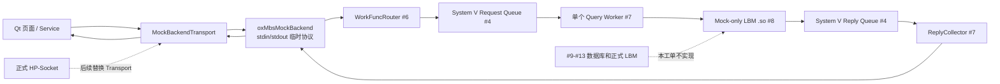

# #24 Mock 后端端到端联调

## 目的

本工单在不启动 #9-#13 的前提下，使用足够多的 Mock 数据验证最终架构中客户端可见的管理、行情、交易和查询功能。管理类请求真实通过已完成的 #1-#8 后端基础设施；行情、交易和查询使用独立 Mock Gateway 模拟最终的 oxMWH、交易网关和查询核心。它不接数据库、不接交易柜台，也不是正式 HP-Socket 协议。



## 当前 Mock 功能清单

| 业务边界 | 页面功能 | Mock 结果 |
| --- | --- | --- |
| 低频管理 | 登录、注销、菜单、数据字典、字典明细、在线日志 | 经过 WorkFunc、Request Queue、Query Worker、Mock LBM 和 ReplyCollector |
| 系统运行 | 服务状态、Worker 数、地址、延迟、最近心跳、托管服务配置 | 返回运行中、降级、维护等状态快照 |
| 用户权限 | 用户、角色、站点、角色菜单权限、用户菜单权限、产品权限、资产权限 | 覆盖分页、筛选、CRUD、启停和权限错误 |
| 产品资金 | 产品、项目、资金账号、资产-资金账号关联 | 覆盖多条关联、暂停关系、分页和 CRUD |
| 风控 | 风控参数、规则、异常事件 | 覆盖启停、阈值修改、事件处理和审计日志 |
| 高频行情 | 报价、Tick、1 分钟 K 线、五档盘口、订阅 | 由 MockMarketGateway 返回，不进入慢查询 IPC |
| 高频交易 | 限价委托、数量校验、资金/仓位冻结、撤单、部分成交、模拟成交 | 由 MockTradeGateway 返回，不代表真实柜台报单或真实风控 |
| 交易查询 | 资金、持仓、委托、成交 | 由 MockQueryGateway 返回，和模拟交易共享演示状态 |

页面中的“登录、权限、资金、风控和成交”都只是 Mock 业务结果；正式语义必须由 #9-#13、正式柜台和 Mentor 确认的 PackMessage 协议接入后才能成立。

## 临时协议边界

- Python 和 `oxMbsMockBackend` 使用一行一个请求/响应的本地管道协议，字段经过百分号编码。
- 业务正文是扁平化表单，例如 `record.display_name=...`，避免为 Mock 引入未经批准的 C++ JSON 第三方依赖。
- `request_id`、文本 `session_id`、service 和 operation 被写进 LBM 正文，并在 LBM 回包中带回。IPC 内部仍使用 #5 的 `task_seq + 数值 session_id + deadline` 三重关联。
- 临时消息号 `900001` 到 `900007` 和 function id `1` 到 `15` 只在 `oxmbs/mock` 下有效，不能作为正式 `PackMessage` 枚举使用。

## 可运行能力

| 场景 | 通过链路 | 说明 |
| --- | --- | --- |
| 登录 | `users.login` | 校验 Mock 用户和密码，返回临时会话快照。 |
| 管理查询 | `page` | 覆盖菜单、字典、服务状态、托管服务、用户/角色/权限、产品/项目/账号关联、风控等资源的分页、筛选和空结果。 |
| CRUD | `create/update/transition` | Mock LBM 生成主键、更新内存快照、写入 Mock 审计日志；页面成功后重新查询。 |
| 权限/服务错误 | `force_unauthorized/force_error` | 返回稳定客户端状态，不把失败伪装成空列表。 |

Mock 后端固定使用一个 Query Worker。`fork` 后的 LBM 内存不能在多个 Worker 之间自动共享，因此多 Worker 会让 CRUD 看见不同副本，不能用来模拟真实数据库一致性。

## 验证命令

```bash
cmake -S . -B build
cmake --build build -j2
ctest --test-dir build --output-on-failure
PYTHONPATH=client .venv/bin/python -m unittest discover -s tests/python -v
PYTHONPATH=client .venv/bin/python -m compileall -q client/vnpy_oxapp
```

运行桌面端前，先构建 `build/bin/oxMbsMockBackend`。若构建目录不在默认位置，可设置 `OXAPP_MOCK_BACKEND_PATH` 指向该本地可执行文件。

## 后续替换点

后续 #9-#13 完成时，以正式 LBM 和数据访问实现替换 Mock LBM；后续正式协议确认后，以 HP-Socket Transport 替换 `MockBackendTransport`。Qt 页面、Service、`ClientProtocolClient` 和请求响应关联模型不应因此改写。
