# OX-P0-04 客户端正式 Transport 接入阶段说明

## 一句话结论

本阶段把 oxApp 的客户端传输选择改为配置驱动：默认仍可运行 Mock，但显式启用
`hpsocket` 后，Qt 业务服务会通过 Python `HpSocketTransport` 请求 C++ oxMBS，
并从 PostgreSQL `ta_data` 返回真实 QMT 最新行情。

## 做了什么

| 工作 | 技术实现 | 结果 |
| --- | --- | --- |
| 运行模式选择 | `ClientRuntimeConfig` + INI/`OXAPP_*` 环境变量 | 不改页面即可在 Mock 和正式 Socket 间切换 |
| 正式客户端接入 | Python 标准 TCP Socket + `PackMessageCodec` | 客户端 reader 线程可拆包、回包并交给 `ClientProtocolClient` |
| QMT 最新行情查询 | `MarketService.list_quotes()` -> `quote.latest` | 请求包含 `schema_version/request_id/data`，响应保留 `source=QMT/PG` |
| 页面数据边界 | 正式模式只显示 `quote.latest` | Tick、K 线、五档和 Push 未完成时明确报错，不回退 Mock |
| 会话注入 | `OxAppMainWindow(session_id=...)` | 会话标识由部署配置传入；认证状态仍由后续登录工单决定 |

## 当前链路图

```mermaid
flowchart LR
    UI[Qt 行情页面] --> MS[MarketService]
    MS --> CPC[ClientProtocolClient]
    CPC --> RT[HpSocketTransport]
    RT -->|PackMessage TCP| HP[C++ HP-Socket Server]
    HP --> WR[WorkFuncRouter]
    WR --> RQ[Request Queue]
    RQ --> W[Query Worker]
    W --> S[QmtServiceRouter]
    S --> PG[ta_data PostgreSQL]
    PG --> RC[ReplyCollector]
    RC --> HP
    HP --> RT
    RT --> UI
```



线程/进程边界：Qt 控件运行在 Qt 主线程；`HpSocketTransport` 的 TCP reader、心跳和重连各自为客户端后台线程；
C++ oxMBS 主进程负责 HP-Socket、路由和 ReplyCollector；Query Worker 是独立子进程；数据库连接只在 Worker 内使用。

## 代码位置

| 功能点 | 对应文件 | 关键符号 | 输入 -> 处理 -> 输出 |
| --- | --- | --- | --- |
| 运行模式配置 | `client/vnpy_oxapp/runtime_config.py` | `ClientRuntimeConfig`, `load_client_runtime_config()` | INI/环境变量 -> 校验 host/port/mode -> Transport 配置 |
| 启动入口替换 | `client/vnpy_oxapp/app.py` | `main()` | runtime config -> 创建正式或 Mock Transport -> 注入主窗口 |
| QMT 查询请求 | `client/vnpy_oxapp/services/market_service.py` | `list_quotes()`, `_parse_qmt_selection()` | 页面筛选 `688693.SH` -> 市场码 `1`/代码 `688693` -> `quote.latest` |
| 正式行情表 | `client/vnpy_oxapp/ui/market_page.py` | `MarketPage` | QMT/PG 字段 -> Qt 表格，显示行情时间、入库时间和来源 |
| 会话边界 | `client/vnpy_oxapp/ui/main_window.py` | `OxAppMainWindow(..., session_id=...)` | 配置会话标识 -> 各页面 Service 读取；不代表已经认证 |
| 配置模板 | `config/oxapp.ini.example` | `[transport]` | `kind=mock/hpsocket`、服务地址和超时 |

## 真实验收结果

使用真实 C++ 服务和真实 PostgreSQL 连接完成一次客户端请求：

```text
transport_connect=True
status=succeeded
instrument_id=1:688693
name=锴威特
last_price=73.74
quote_time=2026-09-14 14:46:49+08
receive_time=2026-09-14 14:46:48.673586+08
source=QMT/PG
```

这条结果来自 `ta_data.stkprice`，不是 `MockBackendTransport` 或 `MockMarketFeed`。

## 验证命令

```bash
PYTHONPATH=client python3 -m unittest tests.python.test_runtime_config tests.python.test_market_service tests.python.test_hpsocket_transport -v
PYTHONPATH=client python3 -m compileall -q client/vnpy_oxapp tests/python
git diff --check
```

## 面试讲解方式

可以这样讲：

> 我把 Qt 页面和传输实现解耦，通过配置工厂在 Mock 与正式模式之间切换。正式模式下，页面服务只构造业务语义请求，`HpSocketTransport` 负责 PackMessage 编解码、TCP reader 线程和请求关联；C++ 服务把请求路由到 Query Worker，Worker 通过 `QmtRepository` 查询 `ta_data`，`ReplyCollector` 再按请求和会话把结果回传。这样页面不直连数据库，高频行情 Push 也不会混入低频查询队列。

## 未完成边界

- `auth.login`、Token/Session 续期和权限校验仍属于 `OX-P0-05`，当前注入的 session 只用于联调，不代表真实登录。
- `quote.subscribe`、实时行情广播、序列号和慢客户端策略属于 `OX-P1-01`，本阶段不把一次性查询宣称为实时 Push。
- 交易、TLS、历史 Tick/K 线/五档表均未实现。
