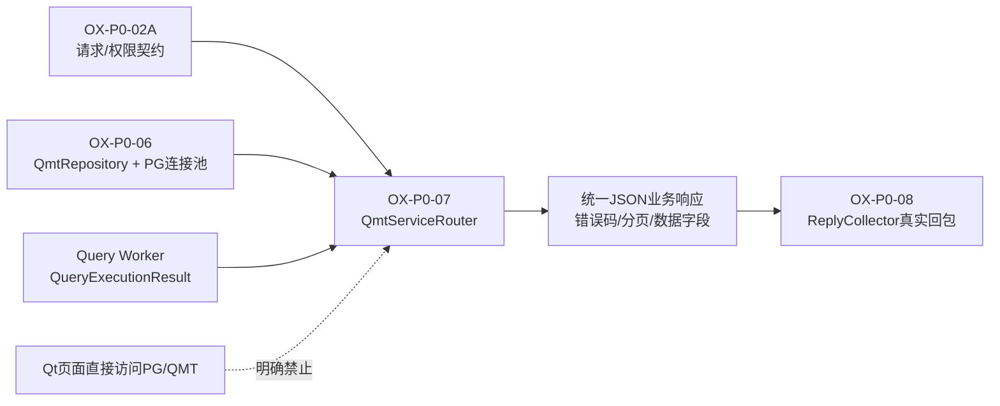

# OX-P0-07 阶段完成说明：QMT 业务 Service 与请求路由

## 1. 一句话结论

本阶段已把经过 Worker 的低频任务接入 QMT/PG 业务服务：请求经过路由后可以调用 `QmtRepository` 查询真实的 QMT PostgreSQL 数据，并以统一响应模型返回。当前已具备前后端接口联调基础，但 `ReplyCollector -> HpSocketServer::send_to_session` 的真实 TCP 回包接线属于下一阶段 `OX-P0-08`，因此本阶段不宣称 Qt 页面已经完成真实数据端到端展示。

## 2. 完成内容

| 功能点 | 对应文件 | 关键类/函数/测试 | 输入 -> 处理 -> 输出/副作用 -> 验证 |
| --- | --- | --- | --- |
| QMT Service 路由 | `include/oxmbs/service/qmt_service_router.h`、`src/oxmbs/service/qmt_service_router.cpp` | `QmtServiceRouter::execute()`、`resolve()` | `msg_type + func_id` -> 查找冻结路由 -> 进入 `InstrumentSearch`、`CalendarPage`、`QuoteLatest` 或明确返回未提供能力 -> `oxmbs_qmt_service_router_test` |
| PostgreSQL 仓储适配 | `include/oxmbs/service/qmt_service_router.h`、已有 `include/oxmbs/storage/qmt_repository.h` | `IQmtRepository`、`QmtRepositoryAdapter` | Service 只依赖只读接口 -> 适配现有连接池和预编译 SQL -> 不复制连接池或 SQL 所有权 -> 编译和内存替身测试 |
| 证券/期货主数据查询 | `src/oxmbs/service/qmt_service_router.cpp` | `QmtOperation::InstrumentSearch` | JSON 请求 -> 严格字段校验、市场码判断、`Y=0+1+2` 展开 -> 分页 JSON 响应 -> 分页和空结果测试 |
| 交易日历查询 | `src/oxmbs/service/qmt_service_router.cpp` | `QmtOperation::CalendarPage` | 日期/市场筛选 -> 调用 `list_calendar` -> 返回 `markets`、`source`、`is_y_derived` -> 编译与路由测试 |
| 最新行情查询 | `src/oxmbs/service/qmt_service_router.cpp` | `QmtOperation::QuoteLatest` | 股票/期货标的选择 -> 分流到 `stkprice` 或 `ft_stkprice` -> 返回 QMT/PG 行情字段 -> 路由入口已接通 |
| 错误码映射 | `include/oxmbs/network/pack_message.h`、`src/oxmbs/service/qmt_service_router.cpp` | `PgUnavailable=2101`、`PgTimeout=2102`、`repository_result()` | Repository 错误 -> 转为稳定公开错误码和消息 -> 不泄露 SQL/凭据 -> 连接不可用、超时测试 |
| Worker 入口适配 | `include/oxmbs/service/qmt_service_router.h`、`src/oxmbs/service/qmt_service_router.cpp` | `QmtServiceRouter::handle()` | `IpcTaskMsg` -> 调用 Service -> 转成 `QueryExecutionResult` -> 保留现有 Worker 的 deadline、ReplyCollector 和队列边界 -> Handler 测试 |
| 构建注册 | `CMakeLists.txt`、`tests/CMakeLists.txt` | `oxmbs_core`、`oxmbs_qmt_service_router_test` | 源文件加入 CMake -> 完整目标可编译 -> CTest 注册成功 |

## 3. 当前工单图



本阶段实现：QMT/PG 查询服务、请求路由、分页、错误映射和 Worker Handler。

本阶段不实现：真实 HP-Socket 回包、Qt 页面改造、交易、TLS、QMT SDK 在 C++ 中直连。

## 4. 端到端架构位置

```text
Python/Qt 页面
    -> HpSocketTransport（已存在，发送 PackMessage）
    -> C++ HP-Socket Server（已存在，OX-P0-03）
    -> WorkFunc 低频白名单/Request Queue（已存在）
    -> Query Worker（已存在）
    -> QmtServiceRouter（本阶段）
    -> QmtRepository / PostgreSQL ta_data（OX-P0-06）
    -> Reply Queue
    -> ReplyCollector（已存在）
    -> [OX-P0-08 接入] HpSocketServer::send_to_session
    -> Python/Qt 响应回调
```

## 5. 请求与响应约定

业务 payload 当前使用版本化 JSON，外层字段如下：

```json
{
  "schema_version": 1,
  "request_id": "req-1001",
  "data": {
    "market": "0",
    "keyword": "000001"
  },
  "page": {
    "page_size": 50,
    "page_token": "v1:0",
    "sort": "stkcode",
    "descending": false
  }
}
```

响应保持 `schema_version/data/error_code/message/warnings` 结构。业务关联仍由跨进程 `task_seq + session_id + deadline` 完成，`request_id` 只作为业务正文中的客户端追踪字段，不替代 IPC 关联键。

已接入能力：

- `instrument.search`：股票/可转债/回购主数据和期货主数据；
- `calendar.page`：交易日历和 `Y` 派生信息；
- `quote.latest`：股票最新行情和期货最新行情；
- `bar.page`、`tick.page`、`depth.latest`：当前 PG 核心表没有对应历史/深度数据，明确返回 `FunctionNotAvailable`，不伪造数据。

## 6. 验收结果

执行命令：

```bash
cd /root/projects/TA/oxApp
cmake --build build --target oxmbs_qmt_service_router_test -j2
ctest --test-dir build --output-on-failure -R oxmbs_qmt_service_router_test
```

结果：

- 构建：通过；
- QMT Service Router CTest：`1/1` 通过；
- 覆盖：正常主数据查询、分页游标、空结果、非法 JSON、未提供能力、未认证、PostgreSQL 不可用、PostgreSQL 超时、Worker Handler；
- QMT/PG 真实数据底座：前序验证 `ta_data` 质量检查 `pass=true`，主数据和最新行情已存在；
- 未执行：WSL 到 Windows PostgreSQL 的 live-smoke、真实 TCP 回包联调、长时间稳定性测试。

## 7. 与现有前端/后端能否联调

可以分两层进行：

1. **现在可以做的接口联调**：使用现有 Python/Qt `HpSocketTransport` 组装 `PackMessage`，后端把请求解析并转成 `IpcTaskMsg`，Worker 调用 `QmtServiceRouter`。这层可以验证字段、权限、分页、错误码和 Service 返回结构。
2. **下一阶段才能完成的完整联调**：`ReplyCollector` 关联成功后调用 `HpSocketServer::send_to_session()`，再由 `HpSocketTransport` 的 response callback 交给 Qt 页面。该连接属于 `OX-P0-08`，完成后才能在现有前端页面直接看到真实 QMT/PG 数据。

前端和后端的边界保持不变：Qt 不直连 PostgreSQL/QMT；C++ Service 不把数据库连接或 Socket 交给 Worker；`ReplyCollector` 只负责关联和调用 sink。

## 8. 面试讲解

“我在 QMT 数据底座之上增加了一个只读 Service Router。它通过 `msg_type + func_id` 做路由，严格校验版本化 JSON 和分页参数，再调用带连接池、预编译 SQL 和超时控制的 Repository；QMT 的市场码、`Y` 集合、股票/期货表分流都封装在服务层。Worker 只执行任务并回写统一结果，网络回包由下一层通过 `ReplyCollector` 关联后发送，保证页面、业务和通信边界分离。”

## 9. Git 状态

- 分支：`feature/30-oxmbs-qmt-services-router`
- 基线：`b2616d7`（`OX-P0-06`）
- 本阶段提交：完成验收后记录在此处；未推送远程。
