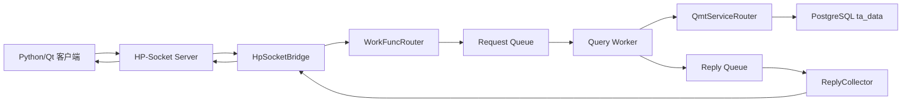

# OX-P0-08：ReplyCollector 真实 HP-Socket 回包桥接

## 这次完成了什么

本工单把已有的 `PackMessage`、低频 `WorkFuncRouter`、System V 双队列、Query Worker、QMT Service、`ReplyCollector` 和 HP-Socket Server 装配成一条真实低频链路。客户端请求进入 HP-Socket 后，会经过低频白名单和非阻塞 Request Queue，Worker 在自己的进程内打开 PostgreSQL 连接并调用 QMT Service；结果回到 Reply Queue 后，由 `ReplyCollector` 精确匹配，再转换成 `PackMessage` 回到原 session。

## 架构工作图

## 使用的技术

- C++17、CMake、HP-Socket TCP Server。
- System V Request/Reply Message Queue。
- `task_seq + session_id + deadline` 关联和超时清理。
- PostgreSQL `libpq` 连接池；每个 Worker 在 `fork` 后独立建立连接，避免跨进程复制数据库连接句柄。
- QMT Service 路由：`instrument.search`、`calendar.page`、`quote.latest`。
- 回包使用正式 `PackMessage`，保留 `request_id`、`session_id`、消息类型、函数编号和 Worker 序号。

## 代码对应关系

| 功能 | 代码位置 | 说明 |
| --- | --- | --- |
| 网络请求进入低频路由 | `include/oxmbs/network/hp_socket_bridge.h`、`src/oxmbs/network/hp_socket_bridge.cpp` | 校验请求、绑定 session、调用 `WorkFuncRouter`；失败立即回统一错误包。 |
| 正式 PackMessage 适配 | `include/oxmbs/routing/workfunc_router.h`、`src/oxmbs/routing/workfunc_router.cpp` | 将网络 payload 深拷贝为 IPC Task，队列满时非阻塞失败并回滚 pending。 |
| request_id 关联 | `include/oxmbs/ipc/task_correlation.h`、`src/oxmbs/ipc/task_correlation.cpp` | request_id 只保存在主进程关联表，Reply 精确匹配后再回填。 |
| ReplyCollector 回包 | `src/oxmbs/worker/reply_collector.cpp` | 先校验协议和关联，再调用桥接 ResponseSink；错会话、迟到、重复 Reply 不回客户端。 |
| Worker 私有数据库连接 | `include/oxmbs/worker/query_worker_runtime.h`、`src/oxmbs/worker/query_worker_runtime.cpp` | 新增 fork 后 start hook，Worker 自己打开 PG pool。 |
| 生产主进程装配 | `src/oxmbs/main.cpp` | 建立 QMT Repository/Service、路由器、ReplyCollector、HP-Socket 回调和 PG 预检。 |

## 面试时怎么讲

“我没有把数据库连接从主进程复制到子进程，而是让主进程只做 PostgreSQL 预检，Worker 在 fork 后通过启动钩子建立自己的 libpq 连接池。网络层只负责协议和 session，WorkFuncRouter 只做白名单、深拷贝、关联登记和非阻塞入队，真正查询在 QMT Service/Repository 中执行。ReplyCollector 通过 task_seq、session_id 和 deadline 三重校验后，再由桥接层转换为 PackMessage 回原连接，因此慢查询不会阻塞 HP-Socket 和高频链路。”

## 验收结果

- `cmake --build build -j2`：通过。
- `ctest --test-dir build --output-on-failure`：19/19 通过。
- `git diff --check`：通过。
- 本工单未实现交易、TLS、行情广播和 Qt 页面改造。

## 当前限制

- 正式认证登录流程尚未在主进程桥接中展开；当前 QMT 查询要求客户端已提供非零 `session_id`。
- `message_type=2/function_id=1..3` 是当前已冻结的 QMT 查询路由；其他能力仍会返回不可用错误。
- 生产运行仍需通过环境变量 `OXMBS_DATABASE_URL` 或 `DATABASE_URL` 注入数据库连接信息，仓库不保存密码。

## Git

- 分支：`feature/31-oxmbs-reply-bridge`
- 当前提交：完成代码和文档后提交 `feat(oxmbs): bridge QMT replies to HP-Socket (OX-P0-08)`。
