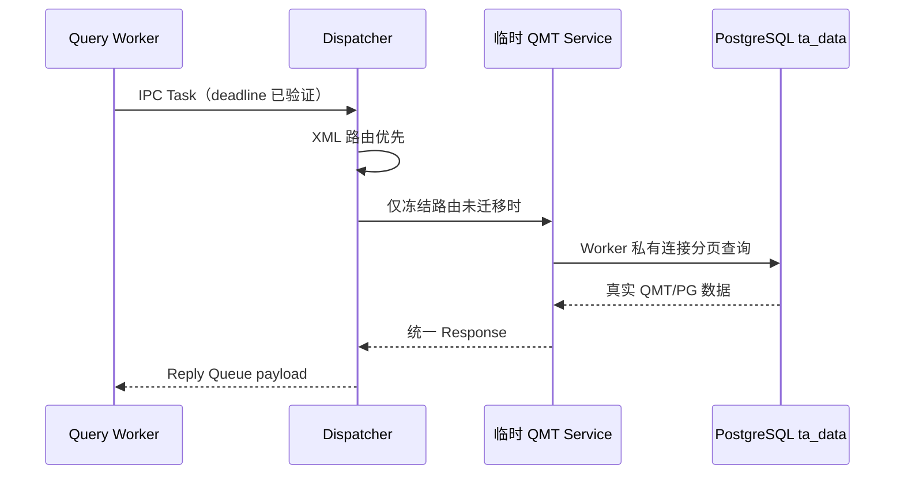

# OX-P0-09：LBM 生产运行时接线

## 背景与目标

此前 Query Worker 直接调用 `QmtServiceRouter::handle`，绕过了 LBM 调度层。本工单把 Worker 的执行入口统一改为 `LbmTaskDispatcher`，为下一张 `OX-P0-11` 将 QMT 查询迁入正式 `lbm_qmt.so` 铺路。

## 当前工单图

本工单实现：Dispatcher 运行时接线、fork 后 Worker 私有 PG/LBM 初始化、三个冻结 QMT 查询的精确桥接、XML 优先级验证。

本工单不实现：`lbm_qmt.so`、实时 Push、交易、TLS、数据库表变更。

## 代码与结果

| 功能点 | 文件 | 关键符号 | 结果 |
| --- | --- | --- | --- |
| Worker 私有资源启动 | `src/oxmbs/main.cpp` | `initialize_worker_runtime()` | fork 后打开本 Worker 的 PG 连接，确认 XML 已加载后才消费请求。 |
| Worker 调用入口 | `src/oxmbs/main.cpp` | `LbmTaskDispatcher::handle` | Query Worker 不再直接绑定 `QmtServiceRouter::handle`。 |
| 迁移桥接 | `src/oxmbs/main.cpp` | `register_builtin_route()` | 仅 `2:1` 标的搜索、`2:2` 日历、`2:3` 最新行情可继续查询真实 PG。 |
| XML 优先 | `src/oxmbs/lbm/lbm_task_dispatcher.cpp` | `execute()` | 正式 XML 路由先执行；只有 `RouteNotFound` 才查精确桥接表。 |
| 启动门禁 | `src/oxmbs/lbm/lbm_task_dispatcher.cpp` | `initialize_worker()` | XML 未加载时拒绝启动，防止桥接绕过配置边界。 |
| 回归覆盖 | `tests/test_lbm_loader.cpp` | `test_dispatcher_prefers_xml_and_only_uses_explicit_builtin_routes()` | 验证未配置拒绝、桥接成功、同键 XML 优先、未知编号继续拒绝。 |

## 数据流

## 验收

- `cmake --build build -j2` 通过。
- `ctest --test-dir build --output-on-failure`：`19/19` 通过。
- 相关 Python 回归：`13/13` 通过。
- 不会将桥接称为正式 `lbm_qmt.so`；未知路由不会获得隐式回退。

## 下一步

`OX-P0-11` 实现 XML 配置的正式 `lbm_qmt.so`。同键正式路由上线后会自动覆盖本工单的临时桥接，主进程、IPC、Worker 和回包链路均无需重写。
