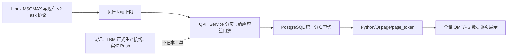
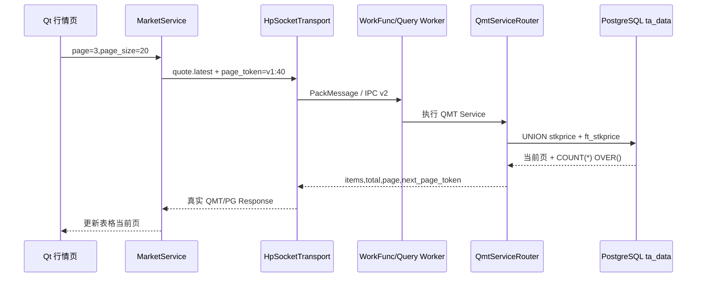

# OX-P0-10：响应容量、分页协议与协议兼容升级

## 背景

`ta_data` 已经具备 QMT 全量主数据和最新行情数据，但 System V IPC 的单帧大小受 WSL/Linux `MSGMAX` 约束，不能把“全量数据”一次性塞进一个响应。上一版客户端还把 `quote.latest` 固定成 `page_size=1`，无法在真实页面浏览全量数据。

## 目标

把低频 QMT 查询改成“服务端分页、客户端逐页浏览”的生产链路，并让 IPC 协议、Worker、ReplyCollector、LBM 输出和 QMT Service 使用同一运行时容量上限。

## 当前工单图



本工单实现：容量限制、分页协议、QMT/PG 全市场最新行情分页、Qt 正式请求参数和验证文档。

本工单不实现：交易、TLS、登录权限完整改造、`OX-P0-09` LBM Dispatcher 接线、`OX-P1-01` 实时行情 Push。

## 具体实现

| 功能 | 文件 | 关键符号 | 处理链路 |
| --- | --- | --- | --- |
| 运行时 IPC 帧上限 | `include/oxmbs/ipc/task_protocol.h`、`src/oxmbs/ipc/task_protocol.cpp` | `systemv_msgmax_bytes()`、`default_task_frame_bytes()`、`TaskProtocolLimits` | 读取 `/proc/sys/kernel/msgmax` -> 与设计封顶 64 KiB 取小值 -> 编码/解码拒绝超限帧 |
| LBM 输出上限 | `include/oxmbs/lbm/lbm_module_loader.h` | `LbmModuleLoaderOptions::max_response_payload_bytes` | 自动预留 56 字节 v2 固定头 -> LBM 结果不能在最终编码阶段溢出 |
| QMT 响应元数据 | `src/oxmbs/service/qmt_service_router.cpp` | `page_data()` | 返回 `items/total/page/page_size/has_more/next_page_token` |
| Service 容量门禁 | `include/oxmbs/service/qmt_service_router.h`、`src/oxmbs/service/qmt_service_router.cpp` | `max_response_payload_bytes`、`QmtServiceRouter::execute()` | Service 生成结果 -> 检查正文长度 -> 超限返回 `FrameTooLarge` |
| 全市场 QMT 查询 | `include/oxmbs/storage/qmt_repository.h`、`src/oxmbs/storage/qmt_repository.cpp` | `list_all_latest_quotes()` | PostgreSQL 将 `stkprice` 与 `ft_stkprice` `UNION ALL` -> 统一排序/分页/COUNT -> 返回真实总数 |
| 正式客户端分页 | `client/vnpy_oxapp/services/market_service.py` | `MarketService.list_quotes()` | 页面页码 -> `page_size/page_token/sort/descending` -> `quote.latest` -> 不回退 Mock |
| Qt 回归断言 | `tests/python/test_market_service.py` | 正式请求测试 | 验证指定标的和空筛选均携带正确分页参数 |

## 数据流



## 容量决策

当前 WSL 已实测：

```text
MSGMAX = 8192 bytes
MSGMNB = 16384 bytes
```

因此当前 IPC 默认单帧上限为 `min(MSGMAX, 64 KiB)=8192` 字节，最大响应正文为 `8192-56=8136` 字节。64 KiB只是设计封顶，不能绕过运行环境的 `MSGMAX`。

## 验收标准

- `TaskProtocolLimits{}` 不超过实际 `MSGMAX`。
- 超过 `MSGMAX` 的 Task 编码返回 `InvalidArgument`。
- QMT 响应包含 `page/page_size/total/has_more/next_page_token`。
- 空市场查询同时覆盖 `stkprice` 和 `ft_stkprice`，数据库侧统一分页。
- 指定 `instruments` 仍保持每个标的一条最新快照。
- Service 响应超过配置正文上限时返回明确 `FrameTooLarge`。
- C++ 构建通过，CTest 19/19 通过。
- Python 正式行情、协议和请求模型相关测试 13/13 通过。

## 生产限制

当前工单完成后，页面可以逐页读取 `ta_data` 的真实数据，但仍不代表完整生产链路已经完成。`OX-P0-09` 仍需让正式 Worker 经过 `LbmTaskDispatcher`；`OX-P1-01` 才会提供独立的实时行情 Push。第一期仍不包含交易和 TLS。

