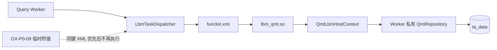

# OX-P0-11：`lbm_qmt.so` 正式模块

## 目标

将 `instrument.search`、`calendar.page`、`quote.latest` 从 `OX-P0-09` 的临时 Service 桥接迁入 XML 配置的正式动态模块，保持 Worker 私有 PostgreSQL 连接、IPC 关联和 ReplyCollector 链路不变。

## 工单图

本工单实现：版本化 LBM 宿主端口、QMT 动态库、三条 XML 路由、独立动态链接边界与加载测试。

本工单不实现：Qt 页面改版、实时 Push、交易、TLS、数据库表变更。

## 代码与链路

| 功能点 | 文件 | 关键符号 | 输入 -> 输出 |
| --- | --- | --- | --- |
| ABI 宿主端口 | `include/oxmbs/lbm/lbm_abi.h`、`include/oxmbs/lbm/qmt_lbm_host.h` | `kLbmAbiVersion=2`、`QmtLbmHostContext` | Worker -> 版本化只读 Repository 端口 -> 模块；模块不拥有 PG/Socket/IPC。 |
| 宿主注入 | `src/oxmbs/main.cpp` | `lbm_options.host_context` | 主进程配置 -> fork 副本 -> Loader -> `LbmRequestView`。 |
| 正式模块 | `src/oxmbs/lbm/lbm_qmt_module.cpp` | 三个 `oxmbs_lbm_qmt_*` 导出 | XML 键 -> 模块内 QMT 业务路由 -> Repository -> JSON Response。 |
| 动态库独立性 | `CMakeLists.txt` | `oxmbs_lbm_qmt` | 编入必要协议实现并显式依赖 PostgreSQL 头文件，不依赖主程序偶然导出符号。 |
| XML 配置 | `config/funclist.xml.example` | `msg_type=2`、`func_id=1/2/3` | 部署目录 `lbm/lbm_qmt.so` -> 三个正式操作。 |
| 模块回归 | `tests/test_lbm_qmt_module.cpp` | `test_qmt_module_loads_from_xml_and_uses_host_repository()` | XML `dlopen` -> `.so` -> 内存 Repository -> 返回 `QMT/PG` 数据。 |

## 验收

- `cmake --build build -j2` 通过，生成 `build/lbm/liboxmbs_lbm_qmt.so`。
- CTest `20/20` 通过，其中新增模块加载测试验证 `.so` 不走临时桥接。
- 相关 Python 回归 `13/13` 通过。

## 下一步

进入 `OX-P0-12`：在 Qt 行情工作台中完成全市场股票/期货的真实数据浏览、筛选、分页、来源与新鲜度展示。模块部署时将 `build/lbm/liboxmbs_lbm_qmt.so` 放入 `funclist.xml` 相对的 `lbm/` 目录。
