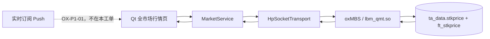

# OX-P0-12：全量 QMT/PG 行情工作台

## 目标

让用户在 Qt 行情中心默认浏览真实全市场股票与期货快照，并可按市场范围、代码或名称筛选、逐页翻阅，同时明确看到数据来源、数量和入库时间。正式模式不混入 Mock，也不展示尚未实现的 Tick/K 线/五档/实时订阅入口。

## 工单图

## 已实现

| 功能点 | 文件 | 用户可见结果 |
| --- | --- | --- |
| 默认全市场 | `client/vnpy_oxapp/ui/market_page.py` | 首次正式查询不再被硬编码单标的限制，直接请求股票和期货合并分页。 |
| 市场与关键词筛选 | `client/vnpy_oxapp/ui/market_page.py`、`client/vnpy_oxapp/services/market_service.py` | 可选择深市、沪市、北交所或六个期货市场，再输入代码/名称。 |
| 分页与数据状态 | `client/vnpy_oxapp/ui/market_page.py`、`client/vnpy_oxapp/ui/table_page.py` | 保留表格上一页/下一页、总条数和当前页；状态条显示 `QMT/PG`、当前页和期货条数。 |
| 数据类型 | `src/oxmbs/service/qmt_service_router.cpp` | 每条真实行情增加 `asset_class=stock/futures`，表格显示类型、行情时间、入库时间和来源。 |
| 正式范围收敛 | `client/vnpy_oxapp/ui/market_page.py` | 正式模式仅保留已有真实 PG 快照的“全市场行情”页，隐藏实时订阅和无真实数据表。 |

## 本地验收

- C++ 构建与 CTest：`20/20` 通过。
- Python 真实行情、协议和模型回归：`14/14` 通过。
- `test_qmt_service_router.cpp` 验证全市场返回股票类型字段。
- `test_market_service.py` 验证全市场分页和期货市场 `F:IF2609` 的正式请求契约。

## 尚未通过的真实联调门禁

当前 Windows PostgreSQL 仅监听 `127.0.0.1:5432`。Windows 本机 TCP 探测成功，但 WSL 的回环、DNS 网关和默认网关均不能访问该端口，导致 `oxMbsBootstrap` 的 PG 预检返回 `ConnectionUnavailable`。因此本工单的页面代码已完成，但不能诚实地标记为“已在当前 WSL 对真实库展示”。

需要先让 WSL 能访问该 PostgreSQL 实例，例如由数据库管理员将 PostgreSQL 监听到受控 WSL 可达地址并配置最小防火墙/`pg_hba.conf` 规则，或批准一个受控的本机端口转发。完成后再启动 C++ 服务和 `OXAPP_TRANSPORT=hpsocket` 客户端，验证页面的真实总条数和多页浏览。

## 下一步

先完成上述真实联调门禁；通过后将 `OX-P0-12` 标为完成，再按总工单顺序进入 `OX-P1-01` 实时 QMT Push。
