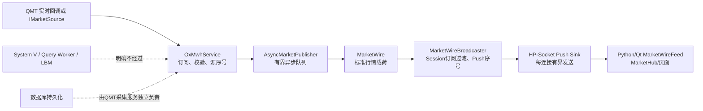
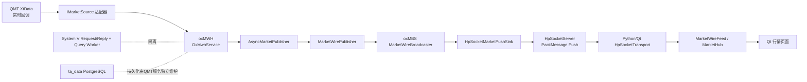
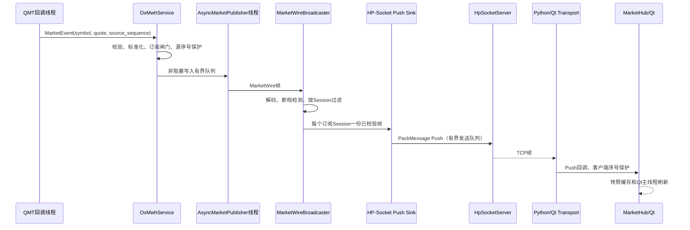

# OX-P1-01 实时行情订阅与 HP-Socket 广播

## 工单目标

把已验证的 QMT 实时行情源接入 oxMBS 的在线行情通道：客户端按 Session 订阅标的，服务端合并并管理订阅，行情经过标准化和序列号保护后以 `PackMessageKind::Push` 广播到对应客户端。行情链路保持高频隔离，不进入 System V Request/Reply Queue、Query Worker、LBM 或 PostgreSQL 慢查询路径。

## 前置依赖

- `OX-P0-03`：C++ HP-Socket Server，提供连接生命周期、Session 绑定和受限发送队列。
- `OX-P0-04`：Python/Qt `HpSocketTransport`，已支持 `Push` 解码和页面回调。
- `OX-P0-07`：QMT 查询/业务路由基础，提供 QMT 数据字段语义；本工单的实时源适配仍独立于低频查询。
- `OX-P0-08`：ReplyCollector 真实回包桥接，保证低频回包与行情 Push 不共用队列。

## 当前工单范围图

本工单实现：行情订阅管理、Session 到客户端的 Push 映射、Push PackMessage 接线、序列号保护、断档快照回调、发送失败和慢客户端统计、断线清理以及 QMT 实时源适配边界。

本工单不实现：交易、TLS、历史 K 线/Tick/盘口表、Query Worker 查询、QMT 采集进程本身的断线故障注入、数据库表结构变更和前端视觉改版。

## 系统上下游图

## 行情推送时序

## 业务协议约定

| 项目 | 约定 |
| --- | --- |
| 请求消息类型 | `3`，对应客户端 `quote` |
| 订阅函数 | `1`，`quote.subscribe` |
| 取消订阅函数 | `2`，`quote.unsubscribe` |
| Push 函数 | `3`，`quote.push` |
| 客户端标识 | 使用已绑定的 `session_id`，广播内部以十进制 Session 字符串作为 client id |
| 订阅 payload | UTF-8 JSON，至少包含 `symbols: string[]`；空数组不代表全市场，必须由调用方明确传入标的 |
| Push payload | UTF-8 JSON，包含 `symbol/exchange/source_time/last_price/volume/turnover/bids/asks/sequence` |
| Push 序号 | 复用已校验行情的源序号；没有源序号时由广播器按源/标的生成单调序列 |
| 断档 | 触发快照恢复回调；本工单记录并请求恢复，不伪造缺失 Tick |

## 具体实现项

1. 将 `MarketWireBroadcaster` 的 `IMarketClientSink` 接入 `HpSocketServer::send_to_session`，把 MarketWire Quote 转换为正式 PackMessage Push。
2. 在 `HpSocketBridge` 处理 `quote.subscribe` / `quote.unsubscribe`，只在已绑定 Session 上更新订阅并返回同步确认 Response。
3. 在 `main` 创建并连接 `MarketWireBroadcaster`、Push Sink 和 `OxMwhService`，行情源通过接口注入；默认不启动未经确认的 QMT 进程。
4. 对连接关闭执行订阅清理，对发送失败记录慢客户端/断线统计；发送路径不等待数据库或低频队列。
5. 保留 `MarketWire` 与 `PackMessage` 的独立协议边界：内部标准行情先解码，再构造 Push JSON，不把 C++ 结构体直接写入网络。
6. 对关键线程、锁、所有权、序号和错误边界补充简洁中文注释。

## 验收标准

- 多个 Session 订阅不同标的时只收到各自标的的 Push，不串流。
- 重复/乱序行情不重复广播；源序号断档可记录并触发快照恢复回调。
- 连接关闭后 Session 订阅被清理，后续行情不会继续发送到已断开连接。
- 单连接发送队列达到上限时该连接发送失败并计数，不能阻塞 QMT 回调、发布线程或其他客户端。
- `quote.subscribe` / `quote.unsubscribe` 不进入 System V Request Queue 或 Query Worker。
- C++ Build、CTest 中的行情回归和 PackMessage Push 解码通过；代码差异无空白错误。
- QMT 真实数据源仍以已有独立 QMT 采集服务为准；本工单不宣称当前机器持续运行 QMT 进程。

## 文件和模块范围

| 文件/模块 | 责任 |
| --- | --- |
| `include/oxmbs/market/market_wire_broadcaster.h` | 广播器接口、订阅和统计 |
| `src/oxmbs/market/market_wire_broadcaster.cpp` | 解码、过滤、序号和发送调度 |
| `include/src/oxmbs/network/*` | HP-Socket Push 适配与连接映射 |
| `include/src/oxmbs/main.cpp` | 服务启动时组装行情链路 |
| `include/src/oxmwh/*` | 源、标准化和有界发布链路 |
| `tests/test_market_*` | 订阅、断档、Push 和慢客户端回归 |

## 依赖、风险和待确认项

- QMT Python 回调与 C++ oxMBS 之间的生产跨进程适配器仍需明确部署方式；本工单先冻结 `IMarketSource` 边界，不把 QMT 原生句柄跨语言传递。
- PackMessage Push 使用已批准的 `3/3` 映射；若 Mentor 后续变更正式枚举，只替换协议映射，不改变 MarketHub 和广播器。
- 第一阶段不启用 TLS、不包含交易；网络访问控制由部署环境承担。

## 预期提交

分支：`feature/32-oxmbs-qmt-market-push`

阶段完成后另附简洁说明，列出技术、线程/进程边界、架构图、代码位置、验收结果和面试讲解。
