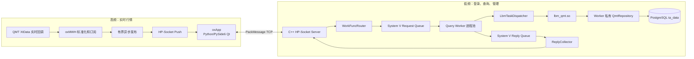
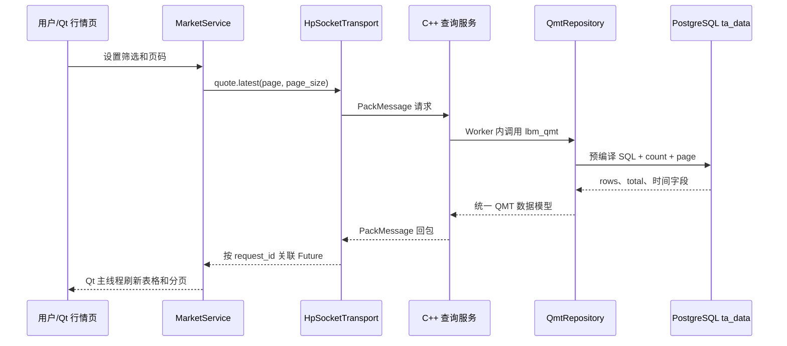

# oxApp x oxMBS x QMT/PG 生产实施路线图

> 版本：v1.3
> 状态：`OX-P0-11` 已完成本地开发和验收，下一步为 `OX-P0-12`
> 规划基线：`b0984de`（原 `feature/33-oxapp-real-transport`）
> 第一期范围：认证、低频 QMT/PG 查询、真实行情浏览、实时行情 Push 和运行保障；不包含交易、不启用 TLS。

## 1. 用一句话说清当前进度

现在已经打通了一条**经过 LBM Dispatcher 的低频真实查询**：Qt 客户端通过 C++ HP-Socket、System V IPC、Query Worker、LBM 调度器和 PostgreSQL `ta_data`，可以显示 `source=QMT/PG` 的真实行情。它证明“前端能查到真实 QMT 入库数据”，但还不是可以上线的全量行情系统。

当前仍缺少正式 LBM 执行、真实数据端到端联调、全量工作台验收和实时推送。因此不能把当前分页代码或单标的查询截图当作“实时行情已经完成”或“生产联调已经验收”。第一期认证工单不再插入当前真实数据竖切路线，交易和 TLS 仍不包含。

## 2. 当前能力表

| 能力 | 状态 | 已经做到的事 | 还不能做的事 |
| --- | --- | --- | --- |
| QMT 到 PG 数据底座 | `PARTIAL` | `ta_data` 有市场、日历、主数据、IPO、股票/期货最新行情；正常实时采集已验证 | 重连、重启、重复、陈旧、跨交易日稳定性尚未验收 |
| 低频真实查询 | `PASS` | Qt -> HP-Socket -> Worker -> PG -> ReplyCollector -> Qt 返回真实数据 | 只验证了少量查询，不是完整行情浏览 |
| 登录和权限 | `PARTIAL` | 有 `AuthService` 的 challenge、会话与权限内核 | 未接入网络路由、真实凭据、Token 续期和登录页 |
| LBM | `PASS` | `lbm_qmt.so` 已实现标的、日历和最新行情三条 XML 正式路由；模块经 Worker 私有 Repository 查询 PG | 模块部署产物需随运行配置发布；其他领域 LBM 不在本期范围 |
| Qt 行情页 | `PARTIAL` | 正式模式已携带分页、排序和游标请求 | `OX-P0-11/12` 完成前不能宣称正式 LBM 和全量工作台验收 |
| 实时行情 Push | `PLANNED` | 有 `oxMWH`、MarketWire 和工单设计 | 尚未接入 QMT 回调并推给正式 Qt 客户端 |

## 3. 最终生产架构：两条通道必须分开

可直接打开查看的图：

- [生产双通道架构图](../diagrams/oxapp-production-architecture.html)
- [生产交付路线图](../diagrams/oxapp-production-delivery-roadmap.html)

低频通道只处理登录、权限、标的搜索、交易日历和**分页快照查询**。QMT 的实时回调绝不能进入 Worker、System V 队列、LBM 或 PostgreSQL 查询通道，否则数据库慢查询会影响行情时效。

## 4. 从页面查看真实数据的过程

页面只能调用 `MarketService`，不能直连 PG；正式模式也不能在查询失败后悄悄回退为 Mock 数据。

## 5. 后续工单执行顺序

| 顺序 | 工单 | 建议实施分支 | 目标 | 完成标志 |
| ---: | --- | --- | --- | --- |
| 1 | `OX-P0-10` 响应容量与分页协议 | `feature/36-oxmbs-response-capacity` | 运行时 MSGMAX、服务端分页、全市场股票/期货合并查询 | 19 项 CTest 与 13 项相关 Python 测试通过 |
| 2 | `OX-P0-09` LBM 生产运行时接线 | `feature/35-oxmbs-lbm-runtime` | 让正式 Worker 经过 `LbmTaskDispatcher` | 本地完成；XML 路由优先，QMT 迁移桥接仅限三个冻结接口 |
| 3 | `OX-P0-11` `lbm_qmt.so` | `feature/37-lbm-qmt` | 标的、日历、行情都经正式 LBM | 本地完成；`funclist.xml -> lbm_qmt.so -> Repository` |
| 4 | `OX-P0-12` 全量 QMT/PG 行情工作台 | `feature/38-oxapp-qmt-workbench` | 全市场、股票/期货、筛选、分页、来源/新鲜度 | Qt 页面看到多页真实数据，无 Mock 回退 |
| 5 | `OX-P1-01` 实时订阅与 Push | `feature/39-oxmbs-qmt-market-push` | 订阅、取消、序号、断档恢复、慢客户端处理 | 多个用户只收到各自订阅的行情 |
| 6 | `OX-P1-02` QMT 稳定性验收 | `feature/40-qmt-realtime-acceptance` | 重连、重启、去重、陈旧、交易日切换 | 每种故障有数据库和恢复证据 |
| 7 | `OX-P1-03` 可观测性 | `feature/41-oxmbs-observability` | 日志、指标、健康检查和告警 | 可区分网络、Worker、PG、QMT、慢客户端故障 |
| 8 | `OX-P1-04` 联调与性能验收 | `feature/42-oxapp-production-integration` | 故障注入、并发、容量、延迟基线 | 异常不串会话、不互相拖慢 |
| 9 | `OX-P1-05` 部署、迁移与回滚 | `feature/43-oxapp-release-ops` | 配置、服务定义、迁移、回滚、运行手册 | 可重复部署并演练回滚 |

以上为未来实施分支，当前不创建空分支。每张工单都从上一张已验收提交新建分支。

## 6. 每张工单的关键边界

### OX-P0-05A：真实认证与授权闭环

实现 `auth.challenge/login/refresh/logout`，使用受控凭据和权限适配器，让 Token/Session 进入 HP-Socket 连接上下文，并在低频 Service 入口鉴权。Qt `LoginPage`、`UserService` 和 `HpSocketTransport` 使用同一份登录契约。

不做交易密码、资金账户权限、第三方 IAM、TLS、多因子认证或前端存储密码。验收要覆盖错误凭据、Token 过期、登出、断线和无 `market.quote.read` 权限的查询；密码、Token 和数据库连接串不得进入日志、仓库或阶段文档。

### OX-P0-09：LBM 生产运行时接线

定义 Worker--LBM 宿主 ABI，约定请求、响应、错误、deadline、日志、Repository 获取和内存所有权。在 `fork` 后由 Worker 初始化 LBM，把正式 Worker Handler 切换到 `LbmTaskDispatcher`，每个 Worker 自己建立 PG 连接。

LBM 不拥有 Socket、IPC 队列、ReplyCollector 或 Session 映射，也不处理实时 QMT Push。验收时一条正式查询必须可追踪为 `funclist.xml -> Dispatcher -> LBM -> Repository`。

### OX-P0-10：响应容量、分页和协议兼容

现有 IPC/LBM 响应上限曾按 4 KiB 设计，只适合单条验证。该工单已统一 PackMessage、IPC 和 LBM 的运行时最大负载：当前 WSL `MSGMAX=8192`，设计封顶 64 KiB 但实际单帧不超过 8192；同时冻结 `page/page_size/total`、最大 `page_size=50`、版本兼容和超限错误码。

不允许整表一次发送或无限制大包。验收必须证明 20、50、100 和允许上限的分页结果完整一致，超限时明确拒绝而不是截断。

### OX-P0-11：`lbm_qmt.so` 正式模块

把 `instrument.search`、`calendar.page`、`quote.latest` 迁移到 `lbm_qmt.so`，经 Worker 宿主调用 `QmtRepository`。保持市场码、代码/名称筛选、股票/期货分类、排序、分页、`source`、`quote_time` 和 `receive_time` 的数据契约。

`Y` 始终是 `0 + 1 + 2` 的业务集合，不是交易所；`9` 是独立的新三板规则；六个期货市场与股票市场不能混用。这个模块不创建新表，不嵌入 QMT Python 句柄，不做实时订阅。

### OX-P0-12：全量 QMT/PG 行情工作台

取消前端 `page_size=1` 和服务端单行覆盖；支持默认全市场、市场/代码/名称筛选、股票/期货分类、服务端分页、总数、数据来源、行情时间、接收时间和新鲜度。正式模式查询失败时显示明确错误，不能改用 Mock 假装成功。

该工单不做 Tick、K 线、五档、交易或 UI 大规模视觉重做。完成后用户应能在 Qt 页面分页查看真实 `stkprice` 与 `ft_stkprice` 数据。

### OX-P1-01：实时 QMT Push

在已有 [实时行情工单](OX-P1-01-qmt-market-push.md) 的基础上，先完成 P0-12 的认证与真实工作台，再实现 `quote.subscribe/unsubscribe/push`。实时链路是 `QMT 回调 -> oxMWH -> 有界发布 -> HP-Socket Push -> Qt`，带 Session 隔离、序号、断档恢复和慢客户端限流。

### OX-P1-02 至 OX-P1-05：上线能力

- `OX-P1-02`：完成 QMT-011/QMT-012 剩余的断连重连、采集重启、重复、陈旧和交易日切换验收；持续验证 `stkprice` 与 `ft_stkprice` 的 `receive_time`。
- `OX-P1-03`：监控连接数、认证、队列深度、Worker 重启、LBM、PG、低频超时、Push 丢弃和行情新鲜度。
- `OX-P1-04`：覆盖未登录、权限不足、Token 过期、断网、PG 故障、满队列、错误 LBM、慢客户端和行情断档的真实联调与性能验收。
- `OX-P1-05`：交付环境变量模板、密钥注入、服务启动顺序、迁移/回滚、灰度和故障恢复 Runbook。第一期没有 TLS，但必须采用内网隔离和访问控制。

## 7. 执行和版本控制规范

1. 新工单开始前检查 `git status --short --branch`、`git diff --check`、`git diff`、`git log --oneline --decorate -5`。
2. 一个工单一个分支，一个或多个小提交；未经明确授权不推送、不建合并请求、不合并。
3. 关键进程/线程、协议长度、内存所有权、连接生命周期和错误映射留简洁中文注释。
4. 每完成一张工单，在 `docs/work-orders/` 和 Windows 工作区 `outputs/` 各写一份简洁阶段说明：做了什么、技术、图、代码位置、验收、局限、下一步和面试讲法。
5. Mock 成功不等于真实 QMT/PG 成功；一次真实查询不等于实时稳定性或上线验收。

## 8. 下一步

下一张应实施的工单是 **`OX-P0-12` 全量 QMT/PG 行情工作台**。当前三个冻结查询已经进入 XML 配置的正式 `lbm_qmt.so`，接下来把真实多页股票和期货行情呈现在 Qt 页面，明确展示数据来源和新鲜度，且不回退为 Mock。`OX-P0-05A` 保留为独立认证能力，不插入当前真实数据竖切顺序。
