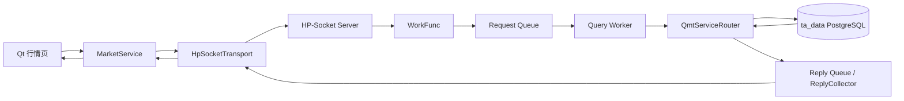

# oxApp `OX-P0-10` 阶段说明

## 一句话结论

本阶段把“只能返回一条 Mock/真实行情”的查询改成了受 IPC 容量保护的真实 QMT/PG 分页查询。Qt 页面现在可以带页码和游标请求全市场快照，服务端从 `ta_data.stkprice` 与 `ta_data.ft_stkprice` 读取并返回真实总数。

## 做了什么

1. 根据 WSL 实际 `MSGMAX=8192` 计算默认 IPC 帧上限，不再写死 4 KiB 或误以为可以直接使用 64 KiB。
2. 给 QMT Service 增加响应正文上限，超限时明确返回 `FrameTooLarge`，让客户端减小页大小。
3. 给分页响应补充 `page`、`page_size`、`total`、`has_more`、`next_page_token`。
4. 在 PostgreSQL 端把股票最新行情和期货最新行情统一合并后分页，避免两张表分别翻页造成漏行和重复。
5. 正式 Python/Qt 行情服务默认使用 20 行一页，最大请求 50 行，并传递 `page_token`、排序和降序参数。
6. 增加 C++ 与 Python 的边界测试。

## 技术怎么讲

面试中可以这样描述：

> System V 消息队列的单条消息长度受 Linux `MSGMAX` 限制，所以不能把 QMT 全量数据一次性返回。我让协议层启动时读取实际 `MSGMAX`，Service 层预留固定头并设置响应正文门禁；数据库查询在 PostgreSQL 端完成统一排序、分页和 `COUNT(*) OVER()`，客户端只保存当前页和下一页游标。这样既能浏览全量数据，也不会因为单帧过大拖垮 IPC 或在回包阶段才失败。

## 架构工作图



## 修改与验证对应关系

| 工作项 | 代码位置 | 验证 |
| --- | --- | --- |
| 运行时帧上限 | `include/oxmbs/ipc/task_protocol.h`、`src/oxmbs/ipc/task_protocol.cpp` | `oxmbs_task_protocol_test`，包含 MSGMAX 超限拒绝 |
| Service 响应门禁 | `include/oxmbs/service/qmt_service_router.h`、`src/oxmbs/service/qmt_service_router.cpp` | `oxmbs_qmt_service_router_test` |
| 全市场统一分页 | `include/oxmbs/storage/qmt_repository.h`、`src/oxmbs/storage/qmt_repository.cpp` | Service 内存替身覆盖股票+期货跨页；生产 SQL 使用 PostgreSQL `UNION ALL` |
| 前端分页请求 | `client/vnpy_oxapp/services/market_service.py` | `tests/python/test_market_service.py` |
| 全局构建回归 | `CMakeLists.txt`、`tests/CMakeLists.txt` | `cmake --build build -j2`、`ctest --test-dir build --output-on-failure` |

## 当前结果

```text
C++ 构建：通过
CTest：19/19 通过
Python 协议/行情相关回归：13/13 通过
真实数据库查询：代码路径已接入 ta_data，需在运行环境设置 OXMBS_DATABASE_URL 后启动 oxMbsBootstrap 验证现场数据
```

## 还没有做的事情

- `OX-P0-09`：正式 Worker 通过 `LbmTaskDispatcher` 执行生产 LBM。
- `OX-P0-11`：真实数据端到端联调门禁和前端全量截图。
- `OX-P0-12`：把全量浏览和真实来源状态固化到联调验收。
- `OX-P1-01`：实时行情订阅、广播、断线重连和 Push。
- 交易柜台和 TLS：第一期明确不包含。

## 下一步

按已确认路线进入 `OX-P0-09`，只做 LBM 生产运行时接线；完成后再推进真实数据端到端联调，不返回 Mock 页面开发路线。
