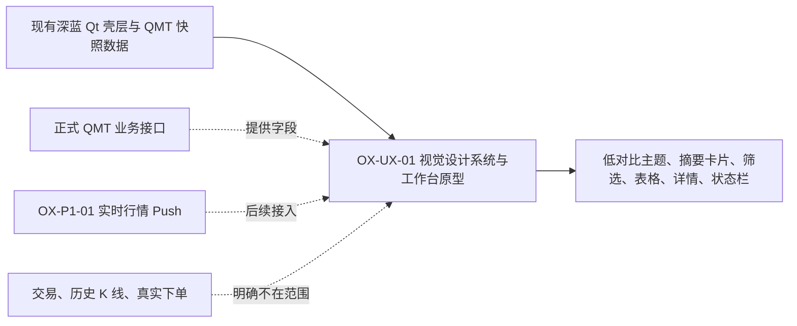

# oxApp OX-UX-01 原型说明

## 原型文件

- [oxapp-frontend-prototype-v2.html](/root/projects/TA/oxApp/outputs/oxapp-frontend-prototype-v2.html)

## 本次解决的问题

- 表格取消刺眼的白色交替行，改为低对比蓝灰层级。
- 用市场摘要卡片解释股票、期货、总量和数据新鲜度。
- 用筛选工具栏区分全市场、0、1、2 和六个期货市场。
- 点击行情行打开详情区，区分主数据、最新行情、行情时间、入库时间和来源。
- 右侧账号配置区保留 Session、权限和环境信息，并可隐藏。
- 底部状态栏显示 HP-Socket、数据库、快照状态和版本信息。
- 增加深浅主题、左侧菜单收起、筛选切换和操作反馈。
- 明确显示当前为“快照”模式，实时 Push 未完成时不伪造实时行情。

## OX-UX-01 工单范围图

本工单实现：视觉 token、信息层级、行情工作台交互原型和可解释状态。

本工单不实现：生产 Qt 代码、实时 Push、交易、历史 K 线、数据库结构变更。

## 交互验收清单

| 交互 | 原型表现 |
| --- | --- |
| 切换市场 | 筛选按钮选中态变化并反馈当前范围 |
| 查看详情 | 点击行高亮，并在右侧显示主数据与行情字段 |
| 隐藏配置 | 顶部配置按钮或右侧箭头隐藏/显示右栏 |
| 收起菜单 | 左侧菜单收起后保留图标和当前选中项 |
| 切换主题 | 全部区域同步切换深蓝/浅色 token |
| 状态反馈 | 刷新、列设置、实时订阅显示轻量 toast |
| 真实边界 | 快照、实时 Push、设计稿样例明确区分 |

## 进入代码前需要确认

1. 是否采用“概览摘要 + 行情列表 + 右侧详情”的主布局。
2. 是否保留右侧账号配置区的固定宽度和隐藏行为。
3. 是否采用低对比蓝灰表格，不再使用白色交替行。
4. 实时 Push 未完成前，页面是否按“快照模式”展示状态。
5. 详情字段以当前八张 QMT 核心表可提供的字段为准，缺少历史数据时不绘制历史曲线。

## v2.1 排版与字体修正

- 页面取消固定 `1180px` 最小宽度，避免窄窗口直接截断右侧配置区。
- 在 1350px、1050px、860px 三档宽度下收缩导航、搜索框和操作按钮，保证布局仍可读。
- 市场筛选按钮禁止异常换行，工具栏允许横向滚动，避免“期货 DFHZIG”被挤成难以识别的多行文字。
- 表格保留可读的最小宽度，单元格使用省略号，避免长时间字段破坏列结构。
- 调整中文标题、摘要卡片、表格行和辅助信息的字号层级，统一字距为 0，减少拥挤感。
- 详情区打开后保持右侧固定宽度，选中行使用低干扰高亮，不再依赖高亮白底区分记录。
- 当前浏览器原型已重新加载检查，市场筛选、行详情、主题切换、左右栏控制均可用。

## 原型到代码的映射

| 原型区域 | PySide6 目标组件 | 正式数据/服务边界 |
| --- | --- | --- |
| 顶部导航 | `TitleBar`、`QPushButton` | 只负责路由和壳层状态 |
| 左侧菜单 | `NavigationPanel`、`QListWidget` | 只负责页面导航和权限可见性 |
| 摘要卡片 | `QFrame`、`QLabel` | 调用 QMT 统计/新鲜度 Service |
| 筛选工具栏 | `QComboBox`、`QLineEdit`、`QToolButton` | 生成正式分页、筛选和排序请求 |
| 行情表格 | `QTableWidget` 或现有表格容器 | 读取 `stkprice`、`ft_stkprice` 及主数据 |
| 详情区 | `QFrame`、`QFormLayout` | 读取选中行的主数据和行情快照 |
| 状态栏 | `QStatusBar`、`QLabel` | 展示 HP-Socket、数据库、查询和 Push 状态 |

## 明确不代表的内容

本 HTML 是交互原型，不是生产页面；表格中的数值是设计稿样例。正式代码阶段必须继续通过 `MarketService -> HpSocketTransport -> C++ -> LBM/Worker -> PostgreSQL` 获取数据，不能把原型静态数据带入生产逻辑。
